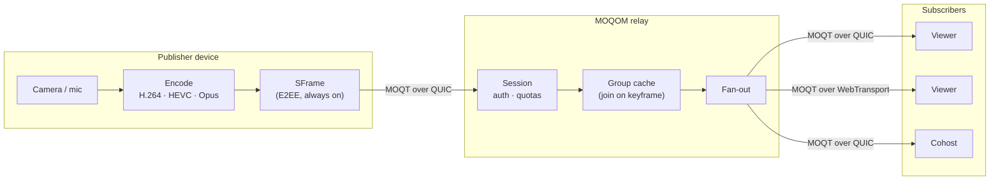
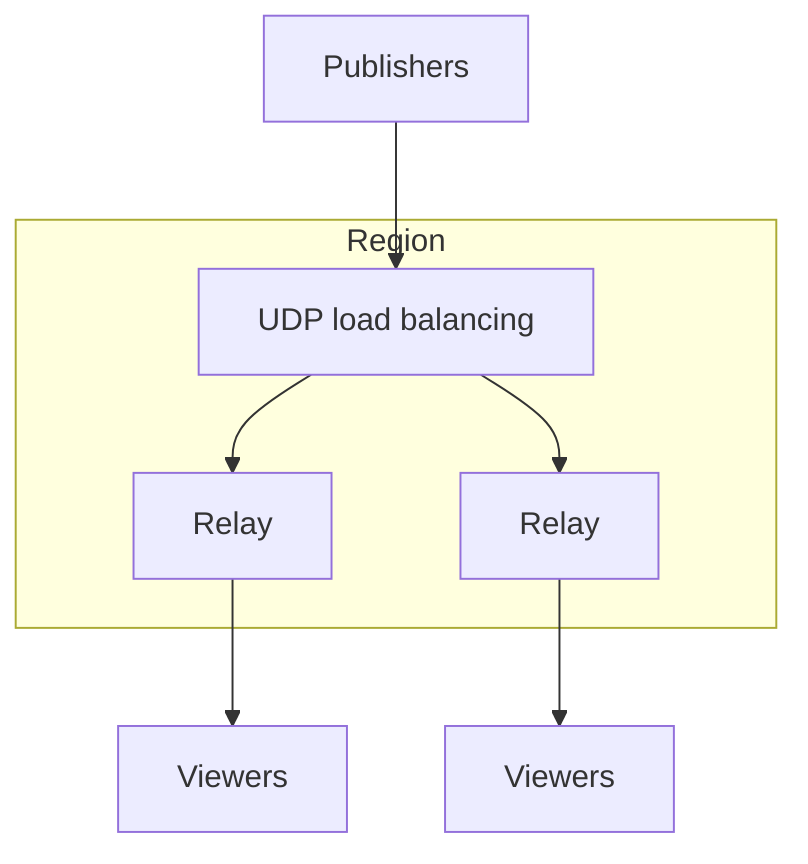

MOQOM is a **publish/subscribe** media system. Publishers push media to a relay; the relay
forwards it to every subscriber that asked for it. There is no mixing and no transcoding in the
relay: it forwards encoded objects.

## Media model

Media over [QUIC](https://www.rfc-editor.org/rfc/rfc9000) organises media as:

- **Namespaces** — a room is a namespace prefix under your tenant; each participant publishes
  under their own namespace within it. Joining a room means subscribing to its prefix, so every
  participant who goes live — including later arrivals — is discovered automatically.
- **Tracks** — one per media stream (e.g. a video quality, an audio stream, a catalog
  describing what a participant publishes).
- **Groups and objects** — a group begins at a keyframe; objects are the frames or packets
  within it.

## What a relay does

| Behaviour | Effect |
| --- | --- |
| **Upstream deduplication** | Each track is pulled from the publisher once, whatever the audience size |
| **Join on a keyframe** | New subscribers receive the group in progress, so playback starts cleanly |
| **Bounded retention** | Recent groups are cached (by groups, bytes and seconds) so reconnects and late joiners can catch up |
| **Slow viewers isolated** | One slow subscriber never stalls the room or the publisher |
| **Per-request authorisation** | Every subscribe and publish is checked against the client's token |
| **Quotas** | Per device and per user, on sessions, subscriptions, announcements and fetches |
| **Publisher stop** | Viewers are told explicitly when a publisher ends |
| **One UDP port** | Raw [QUIC](https://www.rfc-editor.org/rfc/rfc9000) and [WebTransport](https://datatracker.ietf.org/doc/draft-ietf-webtrans-http3/) (HTTP/3) share it |

Because end-to-end encryption covers only payloads, all of the above keeps working in encrypted
rooms.

## Room presence and state

Participants appear in a room by announcing under its namespace; watchdogs (recorders,
classifiers) are disclosed separately as room state and never appear in the roster. Room state —
grants, mutes, stage, spotlight — is shared with every participant, and a client returning from
a network outage recovers it exactly rather than guessing from who happens to be publishing.

## Scale-out

A single relay uses multiple `SO_REUSEPORT` sockets on one port to spread receive load across
cores. Global steering across regions is in development.

## Where MOQOM runs

We plan to partner with Cloudflare, Google Cloud, AWS and other CDNs and content providers. We
don't wait to ship: MOQOM runs on Google Cloud today, and you can
[self-host relays](/guides/self-hosting/) anywhere. No partnership is signed yet.

Continue with [Control plane vs media plane](/architecture/planes/) and
[Standards](/architecture/standards/).
