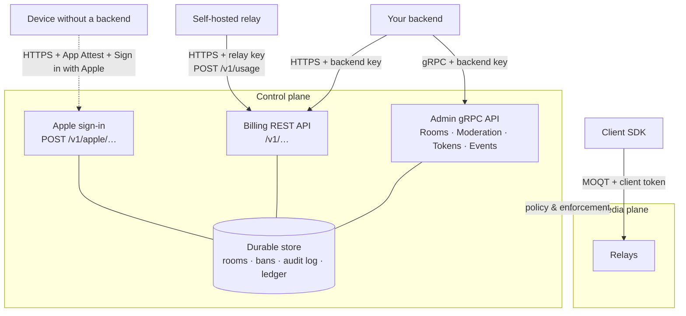

MOQOM separates two jobs that are often tangled together:

| | Control plane | Media plane |
| --- | --- | --- |
| Job | Tenants, rooms, policy, moderation, tokens, billing, events | Carrying audio and video |
| Shape | Request / response, durable state | Streams, real-time, soft state |
| Implemented in | Go, backed by Postgres | Rust (relay), Swift (client) |
| Protocol | gRPC (admin), HTTPS (billing, Apple sign-in) | MOQT over [QUIC](https://www.rfc-editor.org/rfc/rfc9000) / [WebTransport](https://datatracker.ietf.org/doc/draft-ietf-webtrans-http3/) |
| Your code talks to it with | `moqom-go`, `moqom-rust`, REST | `MoqomKit` (and future Web/Android/Desktop SDKs) |

**Nothing in the control plane sits between a publisher and a subscriber.** Administration never
adds latency to media, and changing somebody's grants never requires your backend to link a QUIC
stack.

## Credentials, by path

| Credential | Format | Who holds it | Used on |
| --- | --- | --- | --- |
| Backend API key | `mqk_…` (kind `backend`) | Your servers | Admin gRPC API, billing REST API |
| Relay key | `mqk_…` (kind `relay`) | Your self-hosted relays | `POST /v1/usage` only |
| Client token | Signed and sealed token, ≤ 15 min | A user's device | Relays |
| Enrollment | Sealed, ≤ 30 days, bound to one device key | Devices signed in with Apple, where there is no backend | `POST /v1/apple/token` only |

Each credential can do only its own job: a relay key cannot reach the admin API, a client token
cannot moderate unless its grants say so, and a backend key never leaves your servers.

## Durability

Rooms are records, not side effects of who is publishing. Bans, moderation entries and ledger
entries are written durably before they are reported as done, which is why a room survives its
host's tunnel, a ban survives the target reconnecting, and a usage report can be retried safely.
