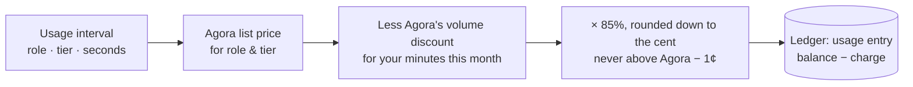

import PriceCards from '../../../components/PriceCards.astro';


MOQOM Cloud is **prepaid, 15% under Agora, with automatic volume pricing**.

1. **Prepaid.** You buy credit up front (minimum $10). Usage draws it down. There are no
   invoices, no commitments and no surprise bills.
2. **15% under Agora.** Each participant-minute is priced at **85% of Agora's Interactive Live
   Streaming list price** for the participant's role and tier, rounded down to the cent.
3. **Volume pricing.** As your participant-minutes on MOQOM Cloud grow in a calendar month (UTC),
   rates drop with the same automatic discount Agora gives, and stay 15% under it.
4. **At least 1¢ under.** Whatever the band, every rate is at least 1¢ under Agora's rate at the
   same volume, per 1,000 minutes. The code enforces it.



## The formula

For each usage record (one participant, one interval) on MOQOM Cloud:

```text
agora(band)  = agora_list(role, tier) × (1 − agora_discount(band))
rate(band)   = min( floor_to_cent(agora(band) × 0.85) ,  agora(band) − $0.01 )
charge       = Σ over the bands the record's seconds fall in:  rate(band) × seconds_in_band / 60,000
```

A record that crosses a band edge is split at the edge, so a month costs the same however its
usage is cut into records.

The live inputs are published at [`GET /v1/rates`](/reference/billing-api/#get-v1rates).

:::caution[Launch pricing]
Launch pricing, subject to change before general availability. The 15%-under-Agora rule and the
1¢ minimum gap are enforced in code at every tier and every band.
:::

| Input | Value |
| --- | --- |
| Share of Agora's price | 85% (`share_basis_points: 8500`) |
| Volume bands | Agora's automatic monthly discounts: none to 100,000 minutes, then 5%, 7% and 10% |
| Self-hosted fee | $0.05 per GiB of egress, the whole price, never above the hosted rate ([why](/billing/self-hosted/#why-005)) |
| Ingress | Free |
| Dedicated relay ([private networks](/guides/private-networks/)) | $0.10 per relay-hour (2 vCPU, 8 GB), cost plus 15%. Usage on it is priced by the formula above |
| Private connectivity | Private Service Connect, VPC peering or overlay access at cost plus 15% |
| Point-to-point calls ([how they work](/guides/peer-to-peer/)) | First 1,000 direct participant-minutes per account each calendar month (UTC) free, then $0.50 per 1,000. Same on MOQOM Cloud and self-hosted. Device-to-device bytes are never charged |

Direct-call minutes are charged on top of the standby relay session each direct participant
keeps open, which is billed by the formula above like any session.

:::note
`GET /v1/rates` is authoritative. If this page and the API disagree, the API is right.
:::

## Rates

Prices per **1,000 participant-minutes**, in US dollars, in the first band (your first 100,000
minutes each month). Hosts and interactive audience share one column; broadcast audience is
cheaper.

| Tier | Agora list (host / audience) | **MOQOM (host / audience)** | Agora list (broadcast audience) | **MOQOM (broadcast audience)** |
| --- | ---: | ---: | ---: | ---: |
| Audio | $0.99 | **$0.84** | $0.59 | **$0.50** |
| HD (≤ 1280×720) | $3.99 | **$3.39** | $1.99 | **$1.69** |
| Full HD (≤ 1920×1080) | $8.99 | **$7.64** | $4.59 | **$3.90** |
| 2K (≤ 2560×1440) | $15.99 | **$13.59** | $7.99 | **$6.79** |
| 2K+ (> 2560×1440) | $35.99 | **$30.59** | $17.99 | **$15.29** |

## Volume bands

Minutes are counted per account, across every role and tier, each calendar month (UTC). Only the
minutes inside a band get its rate.

| Minutes this month | Agora's discount | HD host | Full HD host | HD broadcast audience | Full HD broadcast audience |
| --- | ---: | ---: | ---: | ---: | ---: |
| First 100,000 | — | $3.39 | $7.64 | $1.69 | $3.90 |
| 100,000 – 500,000 | 5% | $3.22 | $7.25 | $1.60 | $3.70 |
| 500,000 – 1,000,000 | 7% | $3.15 | $7.10 | $1.57 | $3.62 |
| Over 1,000,000 | 10% | $3.05 | $6.87 | $1.52 | $3.51 |

Every tier follows the same bands; `GET /v1/rates` lists them all. Agora list prices and volume
discounts are from agora.io, retrieved October 2026, and are re-checked when Agora changes
theirs. Tiers are explained in [Tiers & rates](/billing/tiers/).

## Worked example

A host publishing and receiving HD for one hour, early in the month:

| Step | Amount |
| --- | ---: |
| Agora list, HD host | $3.99 per 1,000 min |
| × 85%, rounded down | $3.39 per 1,000 min |
| 60 minutes × $3.39 / 1,000 | **$0.2034** |
| Agora, same hour | $0.2394 |

The same hour after 1,000,000 minutes that month is 60 × $3.05 / 1,000 = **$0.1830**, against
Agora's $0.2155 at the same volume.

<PriceCards heading="Example scenarios" showKeyPoints={false} />

## What is never charged

- Moderation, room management, events and API calls.
- Platform watchdogs (e.g. MOQOM's own safety classifiers). Your own watchdogs are charged like
  subscribers when `is_billable` is set.
- Recording. A recording or data-capture agent is a room agent (watchdog), so it pays what any
  subscriber pays, with no recording fee on top. Recordings are written to your tenant's own
  bucket; storage is passed through at cost. Self-hosted, you pay your own cloud costs and the
  per-GiB platform fee.

## When credit runs out

When the balance reaches zero, **new sessions are refused**: joins get **402** and
`MintClientToken` gets `FAILED_PRECONDITION`. **Moderation always keeps working.** Turn on
[auto top-up](/billing/top-ups/) to avoid reaching zero.
