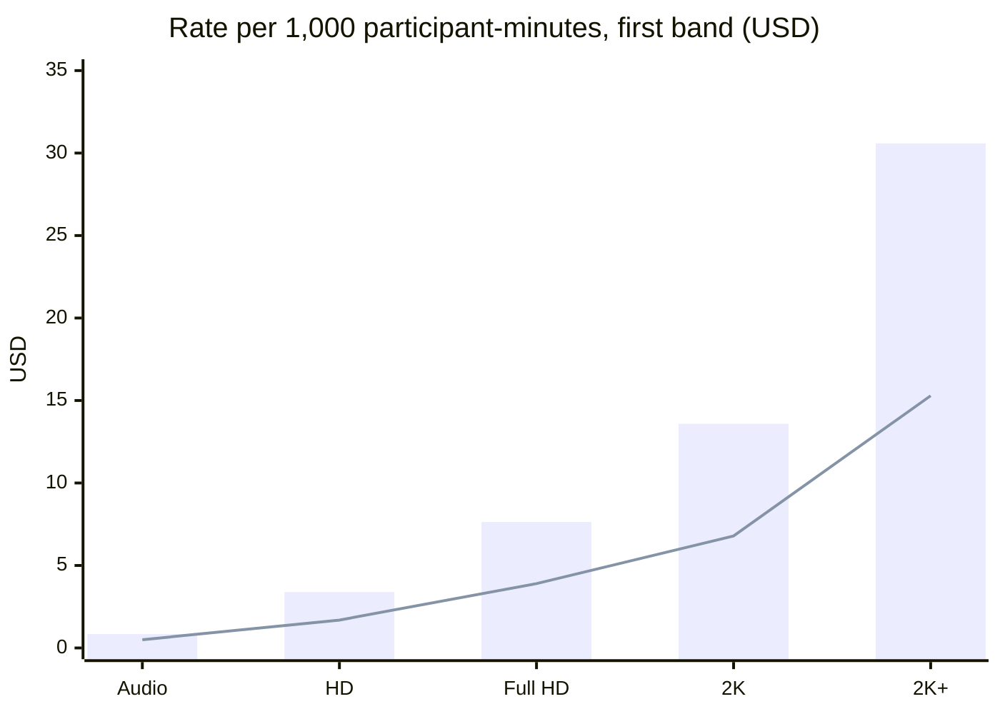

What a participant-minute costs depends on three things: the participant's **role**, their
**tier**, and your account's [volume band](/billing/pricing/#volume-bands) this month.

## Roles

| Role | Who | Rate column |
| --- | --- | --- |
| `host` | Publishes — owners, cohosts, guests on stage | Interactive |
| `audience` | Watches at interactive latency, can be brought on stage | Interactive |
| `broadcast_audience` | Only watches | Broadcast |

## Tiers by aggregate pixels

A participant's tier is set by the **sum of the pixels of every video stream they received at
the same time** — the same boundaries the incumbents bill on, so the rates compare like with
like.

| Tier | `tier` value | Aggregate pixels received | Example |
| --- | --- | --- | --- |
| Audio | `audio` | 0 (audio only) | Voice room |
| HD | `hd` | ≤ 1280 × 720 = 921,600 | One 720p tile, or four 640×360 tiles |
| Full HD | `full_hd` | ≤ 1920 × 1080 = 2,073,600 | One 1080p tile, or two 720p tiles |
| 2K | `2k` | ≤ 2560 × 1440 = 3,686,400 | A 1440p stream, or a grid of nine 640×360 plus a 720p |
| 2K+ | `2k_plus` | > 3,686,400 | 4K, or many large tiles at once |

Bars: host and interactive audience. Line: broadcast audience.

## Rate table

| Tier | Host / audience | Broadcast audience |
| --- | ---: | ---: |
| Audio | $0.84 | $0.50 |
| HD | $3.39 | $1.69 |
| Full HD | $7.64 | $3.90 |
| 2K | $13.59 | $6.79 |
| 2K+ | $30.59 | $15.29 |

Per 1,000 participant-minutes in the first band. Each is 85% of Agora's list price, rounded down
to the cent; past 100,000 minutes a month they drop with [the volume bands](/billing/pricing/#volume-bands).
A charge is prorated to the second: `rate × seconds / 60,000`.

## Keeping tiers low

Because tiers count what a participant *receives*, subscribing to an appropriately sized quality
for each tile keeps viewers in lower tiers. The Swift SDK does this automatically when you report
your layout with `updateLayout` — a 16-person grid on a phone does not need 16 HD streams.
