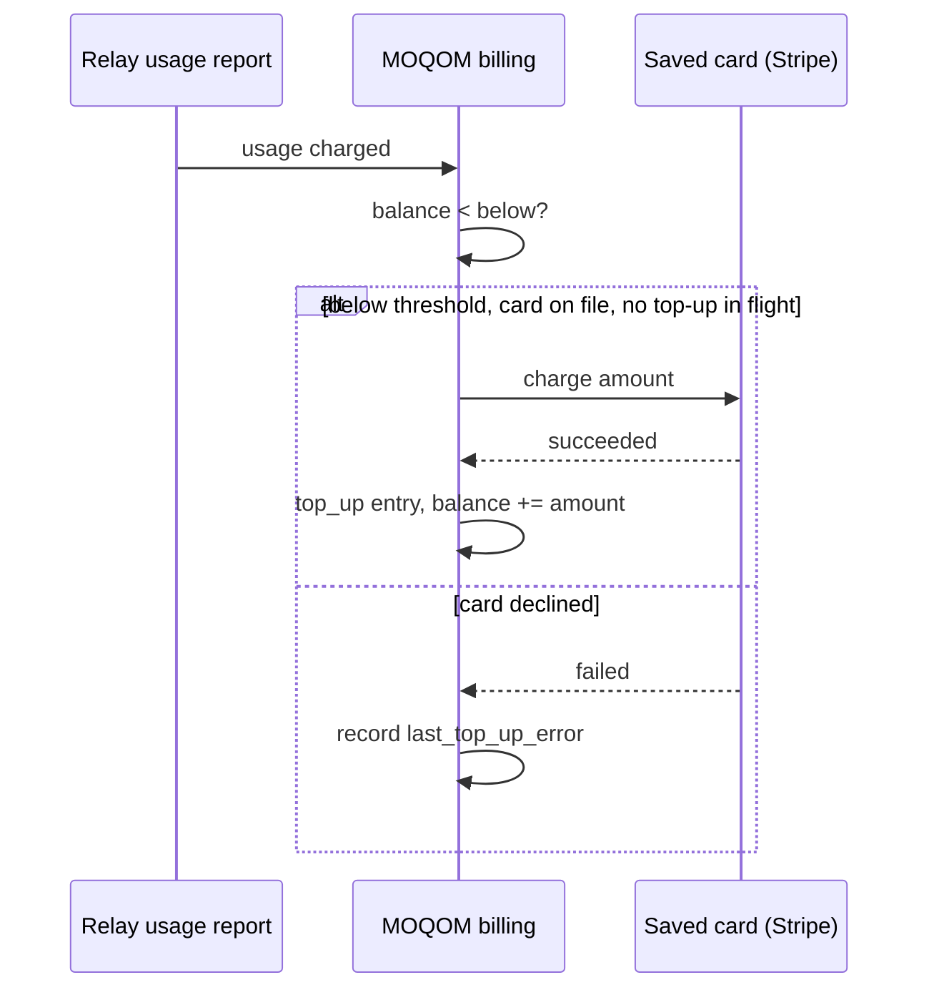

## Manual top-ups

Open a checkout for any amount from **$10.00 to $10,000.00**, in whole cents:

```sh
curl -sS https://api.moqom.cloud/v1/billing/checkout \
  -H "Authorization: Bearer $MOQOM_API_KEY" \
  -H 'Content-Type: application/json' \
  -d '{"amount_cents": 5000}'
# → {"checkout_url": "https://checkout.stripe.com/c/pay/cs_…"}
```

Send the user to `checkout_url`. When the payment succeeds, a `top_up` ledger entry credits your
balance, and a `pending` tenant becomes `active`. Your first top-up at signup defaults to $50.

Paying a checkout saves the card for future automatic top-ups. Manage cards and receipts in the
Stripe customer portal (`POST /v1/billing/portal`).

## Automatic top-up

```sh
curl -sS -X PUT https://api.moqom.cloud/v1/billing/auto-top-up \
  -H "Authorization: Bearer $MOQOM_API_KEY" \
  -H 'Content-Type: application/json' \
  -d '{"enabled": true, "below_cents": 2000, "amount_cents": 10000}'
```

"When my balance drops below $20, charge my saved card $100."



Rules:

- Requires a saved card (`has_card: true` in `GET /v1/billing`).
- Checked after each usage charge. Only one automatic top-up is in flight at a time, so a burst
  of usage never charges your card twice.
- `amount_cents` must be $10.00–$10,000.00; `below_cents` must not be negative.
- A failed charge is recorded in `tenant.last_top_up_error` and cleared by the next success.

Disable with `{"enabled": false, "below_cents": 0, "amount_cents": 0}`.

## Refunds

A refunded payment appears as a `refund` ledger entry that removes the refunded amount from your
balance.
