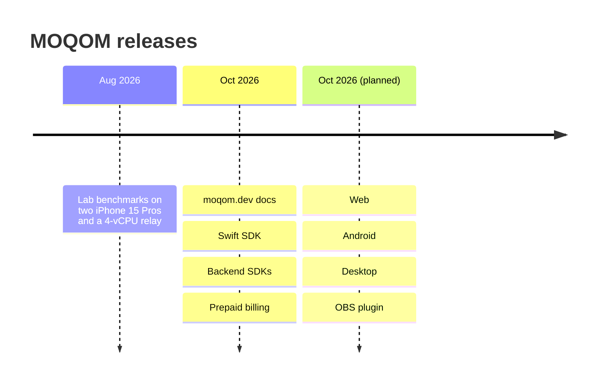

Release notes for the MOQOM service, its APIs and its SDKs. Entries are newest first.

## October 9, 2026

### Security

- **MLS suite is now category 5 throughout.** Every room's group uses
  `MLS_256_MLKEM1024_AES256GCM_SHA512_MLDSA87`, draft-ietf-mls-pq-ciphersuites' category-5
  suite, at private-use code point `0xF0AC` until IANA assigns one: HPKE over pure ML-KEM-1024
  (KEM `0x0042`), HKDF-SHA512, AES-256-GCM and ML-DSA-87. It is the only suite. MOQOM's earlier
  `0xF0AB` (ML-KEM-1024 with ML-DSA-65) and `0xF0AA` (ML-KEM-768), and the X-Wing (`0xF0A1`)
  and X25519 (`0x0001`) suites, are refused as `unsupported`. The suite is
  `MLSCipherSuite.mls256MLKEM1024MLDSA87` in Swift, `SuiteMLDSA` in Go and `CipherSuite::MLDSA`
  in Rust. A key package is 10,373 bytes, and the control plane accepts commits and Welcomes up
  to 3.5 MiB, enough for an 800-member Welcome. Broadcast viewers' keys are ML-KEM-1024. See
  [moqom-mls](/security/libraries/mls/#cipher-suite).
- **Every signature is ML-DSA-87.** Tokens (JOSE `alg` `ML-DSA-87`), device keys and proofs
  (JWK `{"kty":"AKP","alg":"ML-DSA-87","pub":…}`), identity keys, MLS KeyPackages, commits and
  message signatures, direct tickets and the room's control log all move from ML-DSA-65 to
  ML-DSA-87 (FIPS 204, category 5). A token is about 6.8 KB and
  a proof about 11.1 KB. See [Post-quantum authentication](/security/post-quantum/).
- **Every device connection is ML-KEM-1024 only.** MoqomKit connects to relays and to the control
  plane through MOQOM's own Rust QUIC and TLS library (rustls with AWS-LC, the `moqom-direct-ffi`
  library that already carried direct paths), shipped as an XCFramework inside the SDK, so media,
  sign-in and token renewal, and MLS key delivery all use pure `MLKEM1024`. Links between
  MOQOM's servers (relay to relay, relay to control plane, the admin API and the Go SDK to the
  control plane) accept `MLKEM1024`, or hybrid `SecP384r1MLKEM1024` with Go peers, and refuse
  anything weaker. Classical-only key exchange is refused everywhere. See
  [End-to-end encryption](/guides/e2ee/#post-quantum).
- **`api.moqom.cloud` on MOQOM's own TLS terminator.** Billing, the console API and the Go SDK's
  default address are served behind a pass-through load balancer: ML-KEM-1024 preferred, hybrid
  `SecP384r1MLKEM1024` required by the Go SDK, hybrid `X25519MLKEM768` for browsers (the
  strongest any browser offers), and classical-only key exchange refused.
- **No secret in any app.** `POST /join`, the device credential it took, and the control plane's
  option to create a room on join are removed. Every token now comes from something that knows
  who the person is. See [Getting a token onto a device](/reference/device-tokens/), which
  replaces the Join HTTP endpoint page.
- **Sealed tokens.** Every MOQOM token is signed with ML-DSA-87 and then sealed with AES-256-GCM
  under a key only the control plane and relays hold, rotated by key ID. To apps, backends and
  logs a token is opaque bytes; everything a device needs comes back beside it in the token
  response. Relays open and verify offline. BYOC relays receive their own per-tenant seal keys
  over their link. `moqom-token` seals and opens in Swift, Go and Rust, with vectors in
  `vectors/token/seal.json`. See [Sealed tokens](/security/libraries/token/#sealed-tokens).
- **Direct tickets.** On a [direct path](/guides/peer-to-peer/#the-handshake-step-by-step), peers
  no longer show each other their tokens. The relay issues each participant a relay-signed
  ML-DSA-87 ticket about once a minute, and a peer admits a direct connection only with a valid
  ticket for this room and a proof over it from the key the ticket names.
- **Post-quantum authentication.** Every signature that says who someone is, from device
  identity keys and proofs to MLS KeyPackages, commits and messages, direct tickets, join tokens
  and the room's control log, is ML-DSA-87, so a future quantum computer can neither read recorded
  calls nor impersonate a contact. New page:
  [Post-quantum authentication](/security/post-quantum/).
- **ES256 proofs and Ed25519 tokens are no longer accepted.** ML-DSA-87 is the only algorithm
  for tokens, tickets and proofs. Relays refuse ES256 proofs (`unsupported`) and EdDSA tokens, and
  a key set holding an `OKP` or `EC` key is refused with `key_unsupported`. The Ed25519 key
  constructors are removed from `moqom-token`, and Go's `proof.NewProver` takes an ML-DSA-87
  signer only.

### Tokens for apps without a backend

- **Reference token server.** `moqom-sample-tokens`, open source in the MOQOM repository at
  `go/cmd/moqom-sample-tokens`, signs people in with Sign in with Apple and mints publish-only
  tokens for a fixed list of rooms. It deploys to Cloud Run.
- **Apple sign-in hosted by MOQOM.** For apps with no backend at all, the control plane checks
  App Attest and Sign in with Apple and mints itself, for existing rooms you list with
  `SetAppleSignIn`. It never grants moderation and never creates a room.

### Private relay networks

- **Dedicated, BYOC pool lock and Private Connectivity.** Dedicated relays are MOQOM-hosted and
  single-tenant; a BYOC pool can be locked to your tenant; Private Connectivity reaches relays
  over Private Service Connect or VPC peering, with overlay-only relays. Tokens for a private
  tenant name its relay pool: shared relays refuse them, and pool relays refuse everyone else
  (`wrong_pool`). New guide: [Private relay networks](/guides/private-networks/).
- **Pool APIs.** The `RelayPools` service (`CreateRelayPool`, `GetRelayPool`, `ListRelayPools`,
  `ResizeRelayPool`, `DeleteRelayPool`, `SetRelayPoolAccess`, `SetTenantNetwork`) and a `pool`
  field on `CreateRelayEnrollment`, for owner keys. The token response gains `relays`, the
  addresses a pooled token must dial. See the
  [Control-plane gRPC API](/reference/control-plane-grpc/#relaypools) and
  [Error codes](/reference/errors/#relays-private-relay-pools) (`wrong_pool`, `pool_full`).

### Platforms

- **Swift SDK, source-breaking.** `TokenService(url:authorization:certificateHashes:)` calls
  your own token route, the reference token server or Apple sign-in hosted by MOQOM, and
  `TokenService.signIn(url:identityToken:room:device:)` signs in with Apple. `IssuedToken` now
  carries the whole token response: `tenant`, `room`, the full `device` thumbprint, `publish`,
  `mayPublish` and `direct`, with `token` as opaque `Data`. `TokenServiceError.needsSignIn`
  reports a `401`. `RelayInvitation` reads `moqom://join` links that carry no secret, and ignores
  their old `token=` and `key=` parameters. `HTTPMLSDelivery` is configured on its own rather than
  derived from `TokenService`. `DeviceCredentials.publish` takes what the device may publish from
  the token response, since the app can't read the token. See
  [iOS & macOS](/guides/ios-macos/#tokens-and-renewal).

## October 2026

### Security

- **Open-source security libraries** — `moqom-token`, `moqom-proof`, `moqom-sframe` and
  `moqom-mls`, in Swift, Go and Rust under Apache-2.0, with one shared set of test vectors. The
  apps, relays and control plane run them. See [Security libraries](/security/libraries/).
- **Post-quantum device proofs** — the key that binds a token to its phone is [ML-DSA-87](https://csrc.nist.gov/pubs/fips/204/final), held in
  the Secure Enclave. Relays and the join endpoint still accept P-256 keys from older SDKs.
- **Registry-hijack hardening** — CAA, DNSSEC and nightly Certificate Transparency checks on
  every MOQOM domain; phones pin relay and token service certificates.
- **Stricter token and proof checks** — tokens whose header or claims repeat a field name are
  refused, device proofs whose key includes private parts are refused, and `POST /join` requires
  the device's public key rather than accepting a thumbprint on its own.
- **A real 1,024-frame replay window** — [SFrame](https://www.rfc-editor.org/rfc/rfc9605) receivers now track the full window they
  advertise. Previously anything beyond 64 frames behaved as 64.
- **Token renewal on any request** — the Rust client renews a session's token on a subscription
  or an announcement, as well as on a namespace watch, so long sessions never reconnect to
  refresh.
- **Relay and control plane licensing** — the relay and control plane are proprietary and ship
  only as signed binaries. The cryptography that protects your media stays open source in the
  security libraries.

### Documentation

- moqom.dev launched: getting started, guides, API reference, billing, architecture,
  benchmarks and security pages.

### Platforms

- **Swift SDK (`MoqomKit`)** — available for iOS, iPadOS, macOS, visionOS and tvOS 26, shipped
  with a binary core.
- **Backend SDKs** — `moqom-go` and `moqom-rust` cover rooms, moderation, token minting and room
  events.
- **Web, Android, Desktop** — in progress, coming Q4 2026, possibly October.
- **OBS plugin** — scoped, work ongoing.
  See [Platform status](/platforms/status/).

### Billing

- Prepaid credit with Stripe checkout, automatic top-up, and the public rate card at
  `GET /v1/rates`. See [Pricing model](/billing/pricing/).

