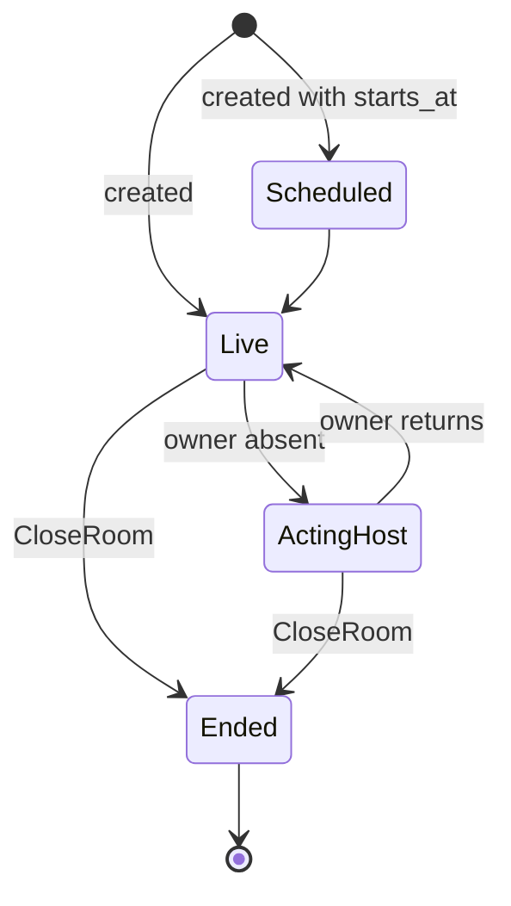

## Tenant

A **tenant** is your account on MOQOM — one customer, one namespace, one prepaid balance. Every
room, participant, API key and ledger entry belongs to exactly one tenant. Tenant IDs look like
`t_3f9a…` and are returned when you [sign up](/reference/billing-api/#post-v1signup).

A tenant has a status:

| Status | Meaning |
| --- | --- |
| `pending` | Signed up, has not yet paid. New sessions are refused with **402**. |
| `active` | Paid at least once. Admitted while the balance is above zero. |
| `suspended` | Suspended by an operator. New sessions are refused with **403**. |
| `archived`, `deleted` | Being torn down or gone. |

## API keys

Keys authenticate your servers to MOQOM. They look like:

```text
mqk_<16 hex characters>_<base64url secret>
```

The fixed `mqk_` prefix makes a key easy to recognise if it is pasted somewhere it shouldn't be,
such as code pushed to a public repository; tools that search code for leaked passwords can be
set to look for it. There are two kinds:

| Kind | Used by | Can do |
| --- | --- | --- |
| `backend` | Your backend | Everything for its own tenant: rooms, moderation, token minting, billing, keys. |
| `relay` | A [self-hosted relay](/guides/self-hosting/) | Only report usage (`POST /v1/usage`). Nothing else. |

A key's secret is shown **once**, when it is issued. MOQOM stores only a hash; a lost key can be
revoked and replaced, never recovered.

## Room

A **room** is a durable record in the control plane, identified by a name you choose (for example
`live/42` or `standup-2026-10-06`). Because the room is a record rather than "whoever is
currently publishing", it survives its host's connection dropping.

A room has a **policy** (age gate, recording policy, residency zone, participant limit, stage
slots, watchdog limit) and a **lifecycle**:



While the owner is absent, the longest-tenured cohost may act as host. That is temporary: the
owner's powers return with the owner, and ownership itself never transfers.

## Participant

A **participant** is one *device* in a room. Identity has two parts:

- **username** — your own identifier for the person, as a string. MOQOM has no numeric user IDs.
- **device** — which of that person's devices, derived from a key the client SDK generates on the
  device.

So "Alice on her phone and her laptop" is two participants and one distinct user. Room
counters report both (`participant_count` and `distinct_user_count`).

## Roles

Pricing and the room model distinguish three ways of taking part:

| Role | What they do | Billing role |
| --- | --- | --- |
| **Host** | Publishes audio/video — owners, cohosts and guests on stage. | `host` |
| **Audience** | Watches at interactive latency and can be invited on stage. | `audience` |
| **Broadcast audience** | Only watches. | `broadcast_audience` |

Roles such as *owner*, *cohost*, *guest*, *moderator* and *viewer* are display labels derived
from a participant's **grants**; they are never stored as a source of truth.

## Grants: publish scopes and capabilities

What a participant may do is a set of **grants**:

- **Publish scopes** — `audio`, `video`, `screen_share`, `data`. A grant is permission, never an
  action: granting video never turns a camera on.
- **Moderation capabilities** — a *set*, not a level, in four groups:

  | Group | Capabilities |
  | --- | --- |
  | Chat | delete message, timeout user, ban from chat, set chat mode, manage filters |
  | Stage | promote to guest, promote to cohost, demote, force mute, spotlight, manage queue, lock stage |
  | Room | kick, ban from room, ban from tenant, close room, change room policy, manage watchdogs |
  | Meta | appoint moderators, read moderation log, handle appeals |

- **Owner** — not a capability. An owner cannot be demoted or acted on by any capability set.

**Presets** expand to common sets: `none` (viewer), `moderator` (chat), `super_moderator`
(chat + stage), `owner` (every capability — still not ownership).

An actor may act on a target only when the actor's capability set is a **strict superset** of
the target's. Two moderators with identical powers cannot act on each other.

## Tokens

A **client token** is the short-lived credential a device presents to a relay. Your backend mints
it through the control plane (`MintClientToken`) for a specific username, device, room and set of
grants. Properties:

- Signed by MOQOM with [ML-DSA-87](https://csrc.nist.gov/pubs/fips/204/final) (`alg` `ML-DSA-87`), a post-quantum signature, then
  [sealed](/security/libraries/token/#sealed-tokens) with AES-256-GCM under a key only the control
  plane and relays hold. To your app, your backend and your logs, a token is opaque bytes:
  everything you need to know about it comes back beside it in the mint response.
- **10 minutes** by default, **15 minutes** maximum. The Swift SDK renews tokens during a session
  via a callback you provide, so calls can run indefinitely.
- Bound to the device it was minted for.
- A service account can never mint a token more powerful than itself.

## Relays

A **relay** terminates [QUIC](https://www.rfc-editor.org/rfc/rfc9000) and [WebTransport](https://datatracker.ietf.org/doc/draft-ietf-webtrans-http3/) connections from clients, checks every request
against the client's token, and forwards media from each publisher to its subscribers. Each
track is pulled from the publisher once, however large the audience. MOQOM Cloud runs relays for
you; with a BYOC licence you can [run your own](/guides/self-hosting/).

A **relay pool** is a set of relays that carries only one tenant's traffic: dedicated relays MOQOM
hosts for you, your own relays, or both. When your tenant is private, its tokens name the pool,
shared relays refuse them and the pool's relays refuse everyone else. See
[Private relay networks](/guides/private-networks/).

## Watchdogs

A **watchdog** is a non-participant observer attached to a room — a recorder, a safety
classifier, an analytics or compliance tap. Watchdogs are disclosed to the room as state (so
participants know they are being recorded), never appear in the roster, and can be restricted to
part of a room.

## Credit

MOQOM Cloud is **prepaid**. Usage draws down a credit balance; when the balance reaches zero, new
sessions and new tokens are refused until you top up. **Moderation and administration always
keep working**, so you can still remove someone from a room when you are out of credit. See
[Pricing model](/billing/pricing/).
