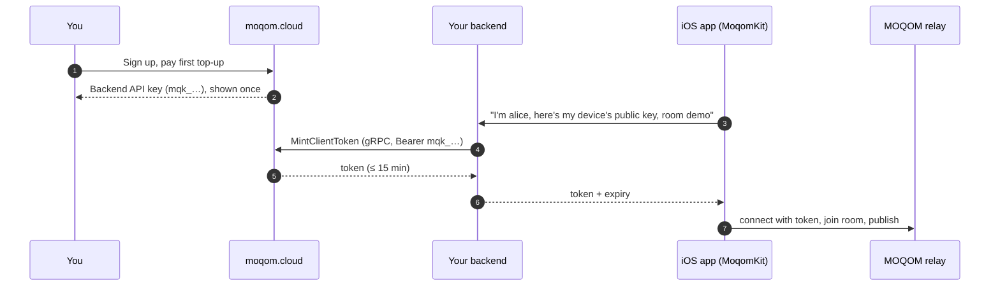

import { Steps, Tabs, TabItem, Aside } from '@astrojs/starlight/components';

This walk-through takes you from nothing to two devices in a room:



<Steps>

1. **Sign up and fund your tenant.**

   Create an account at [moqom.cloud](https://moqom.cloud). You receive a tenant ID, your first
   **backend API key**, and a checkout link for your first top-up. The key is shown once — store
   it in your secret manager now.

   Prefer the API? The same thing over REST:

   ```sh
   curl -sS https://api.moqom.cloud/v1/signup \
     -H 'Content-Type: application/json' \
     -d '{"email":"dev@example.com","name":"Example Inc"}'
   ```

   ```json
   {
     "tenant": "t_3f9a0c1d2e4b5a69",
     "status": "pending",
     "api_key": "mqk_9c1e2f3a4b5d6e7f_x2Vt…",
     "key_id": "9c1e2f3a4b5d6e7f",
     "checkout_url": "https://checkout.stripe.com/c/pay/cs_…",
     "note": "The API key is shown once. Store it now; it cannot be recovered, only revoked and replaced."
   }
   ```

   Open `checkout_url` and pay. When the payment lands your tenant becomes `active`. Until then
   token minting is refused, so no device can join.

2. **Mint tokens from your backend.**

   Your backend already knows who is signed in. Add one route that asks MOQOM for a token for
   that user. Here it is in Go with [`moqom-go`](/guides/backend-go/):

   ```sh
   go get github.com/moqom-cloud/moqom-go github.com/moqom-cloud/moqom-security/go
   ```

   ```go
   package main

   import (
       "encoding/json"
       "net/http"
       "os"

       moqom "github.com/moqom-cloud/moqom-go"
       "github.com/moqom-cloud/moqom-security/go/proof"
   )

   func main() {
       client, err := moqom.Dial("api.moqom.cloud:443",
           moqom.WithCredential(os.Getenv("MOQOM_API_KEY")),
           moqom.WithTenant(os.Getenv("MOQOM_TENANT")))
       if err != nil {
           panic(err)
       }
       defer client.Close()

       http.HandleFunc("POST /moqom-token", func(w http.ResponseWriter, r *http.Request) {
           user := currentUser(r) // your own authentication
           var body struct {
               Key  proof.JWK `json:"key"` // the device's public key
               Room string    `json:"room"`
           }
           if err := json.NewDecoder(r.Body).Decode(&body); err != nil {
               http.Error(w, "bad request", http.StatusBadRequest)
               return
           }
           thumbprint, err := body.Key.Thumbprint() // derived here, never taken from the device
           if err != nil {
               http.Error(w, "bad key", http.StatusBadRequest)
               return
           }
           token, err := client.MintToken(r.Context(), moqom.TokenRequest{
               Username:         user.Name,
               DeviceThumbprint: thumbprint,
               Room:             body.Room,
               Publish:          moqom.PublishCamera, // audio + video
               Preset:           moqom.PresetNone,
           })
           if err != nil {
               http.Error(w, err.Error(), http.StatusBadGateway)
               return
           }
           w.Header().Set("Cache-Control", "no-store")
           json.NewEncoder(w).Encode(map[string]any{
               "token":     token.Token, // sealed: opaque to everyone but MOQOM
               "expiresAt": token.ExpiresAt,
               "tenant":    os.Getenv("MOQOM_TENANT"),
               "room":      body.Room,
               "username":  token.Identity.Username,
               "device":    thumbprint,
               "keyId":     token.KeyID,
               "publish":   []string{"audio", "video"},
           })
       })
       http.ListenAndServe(":8080", nil)
   }
   ```

   The room must exist before a token can name it. Create it once with
   `client.CreateRoom(ctx, moqom.NewRoom{Name: "demo"})`, or from the console.

3. **Add MoqomKit to your app.**

   In Xcode, **File → Add Package Dependencies…** and enter
   `https://github.com/moqom-cloud/moqom-swift`, or in `Package.swift`:

   ```swift
   .package(url: "https://github.com/moqom-cloud/moqom-swift", from: "0.1.0")
   ```

   Add `NSCameraUsageDescription` and `NSMicrophoneUsageDescription` to `Info.plist`, and the
   Keychain entitlement your app already uses for credentials.

4. **Join and go live.**

   ```swift
   import MoqomKit
   import MoqomCore

   func joinDemo(as name: String) async throws {
       // A key generated on this device (Secure Enclave where available).
       let deviceKey = try DeviceKey.installed()

       // Ask *your* backend for a token (step 2). TokenService sends the device's public key,
       // with your app's own session as the bearer, and returns an `IssuedToken`.
       let fetchToken: @Sendable () async throws -> IssuedToken = {
           let service = TokenService(
               url: URL(string: "https://api.example.com/moqom-token")!,
               authorization: try await myAccount.accessToken() // your own sign-in
           )
           return try await service.token(username: name, room: "demo", device: deviceKey)
       }
       let issued = try await fetchToken()

       let identity = ParticipantIdentity(
           username: try Username(issued.username),
           device: try DeviceID(thumbprint: deviceKey.thumbprint)
       )
       let session = MoqomSession(
           transport: MoqtTransport.network(),
           credentials: DeviceCredentials(
               identity: identity,
               token: issued.token,
               deviceKey: deviceKey,
               expiresAt: issued.expiresAt,
               renew: fetchToken // called before expiry; the call continues uninterrupted
           ),
           tenant: TenantID("t_3f9a0c1d2e4b5a69")
       )

       try await session.connect(to: RelayEndpoint(host: "relay.example.moqom.cloud"))
       let room = try await session.join(room: RoomID("demo"))

       // Every room requires end-to-end encryption: without a key, publishing throws
       // MoqomError.encryptionRequired. Every participant needs the same key, distributed
       // over a channel MOQOM does not see. `myKeys.roomKey` is your code and returns `Data`.
       let roomKey = try await myKeys.roomKey(for: "demo")
       await room.useEncryption(RoomEncryption.sharedKey(roomKey, keyID: 1))

       // Publishing is always an explicit act.
       let camera = try CameraSource(format: CaptureFormat(size: PixelSize(width: 1280, height: 720), frameRate: 30))
       camera.start()
       try await room.startBroadcast(from: camera).start()

       let microphone = try MicrophoneSource()
       try microphone.start()
       try await room.startAudio(from: microphone).start()

       for await event in room.events {
           print(event) // participantJoined, muteChanged, grantsChanged, …
       }
   }
   ```

   Run it on two devices with two usernames and they will see and hear each other.

</Steps>

<Aside type="tip">
The relay host in these examples, `relay.example.moqom.cloud`, is a placeholder. Use the relay
endpoint shown for your tenant on [moqom.cloud](https://moqom.cloud).
</Aside>

## What just happened

- Your **API key** authenticated your backend to the control plane. It never left your server.
- Your backend minted a **client token** naming one user, one device, one room, and the right
  to publish audio and video. It expires in at most 15 minutes; the `renew` closure lets the SDK
  fetch the next one without interrupting the call. The token is sealed, so the app passes it on
  without reading it. No backend yet? See
  [Getting a token onto a device](/reference/device-tokens/) for Sign in with Apple options.
- The app set the room's **end-to-end encryption** key before publishing, so the relay forwarded
  ciphertext it cannot read. Encryption is required in every room and can't be turned off; see
  [End-to-end encryption](/guides/e2ee/).
- The app connected to a **relay** over [QUIC](https://www.rfc-editor.org/rfc/rfc9000), joined the room, and published. Every other
  participant's arrival shows up in `room.events` and in `room.roster`.

## Next

- [iOS & macOS guide](/guides/ios-macos/) — room state, mutes, stage invitations, moderation
  callbacks.
- [Moderation guide](/guides/moderation/) — kicks, bans and mutes from your backend.
- [Pricing model](/billing/pricing/) — how usage is charged against your credit.
