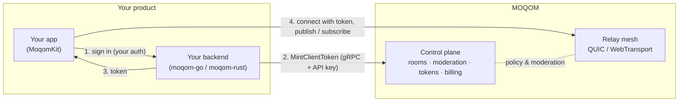

**MOQOM** (Media Over [QUIC](https://www.rfc-editor.org/rfc/rfc9000) Orchestration Mesh) is a real-time media platform for
interactive video and audio rooms, live broadcast, and everything between them, with every
room end-to-end encrypted, with no way to turn it off. It is built
on the IETF's **Media over QUIC Transport** protocol ([`draft-ietf-moq-transport-22`](https://datatracker.ietf.org/doc/html/draft-ietf-moq-transport-22) and [`-19`](https://datatracker.ietf.org/doc/html/draft-ietf-moq-transport-19)) and
consists of:

- **Relays** that receive media from publishers once and fan it out to subscribers.
- A **control plane** that owns tenants, rooms, policy, moderation, tokens and billing.
- **Client SDKs** that join rooms, publish and play media — Swift today, with Web, Android,
  Desktop and an OBS plugin [on the way](/platforms/status/).
- **Backend SDKs** for Go and Rust that your server uses to mint tokens, manage rooms,
  moderate, and follow room events.

You can use the hosted service, **MOQOM Cloud** ([moqom.cloud](https://moqom.cloud)), or run
relays yourself and pay only a [platform fee](/billing/self-hosted/).

MOQOM is automated and turnkey: signup, billing, top-ups, API keys and spend limits are
self-serve, with no sales call or onboarding project. When you need a person, support is there
from the people who built it, at [hello@moqom.cloud](mailto:hello@moqom.cloud).

## What you can build

- **Video and audio calls** — 1:1 calls point to point, phone to phone, and small groups, with
  post-quantum [end-to-end encryption](/guides/e2ee/) in every room.
- **Live rooms with a stage** — hosts and cohosts on stage, an interactive audience that can
  be invited up, and backstage for guests waiting to go live.
- **Broadcast** — one or a few publishers to very large audiences at low latency.
- **Moderated communities** — kicks, bans, force-mutes, spotlight and an audit log, all
  callable from your backend and enforced on live sessions.
- **AI in the room** — MOQOM is AI native. Agents for safety, captions, analytics,
  recording or moderation join over the same protocol and relays as people, with their own
  scoped keys, and are always announced to the room. See
  [moderation and agents](/guides/moderation/).

## Why Media over QUIC

Traditional real-time stacks force a choice between WebRTC (interactive, but expensive to fan
out) and HLS/DASH-style streaming (cheap to fan out, but seconds of latency). Media over [QUIC](https://www.rfc-editor.org/rfc/rfc9000)
gives a single protocol that does both: publishers push media to relays over QUIC, and relays
forward it to subscribers with publish/subscribe semantics, caching and prioritisation.

MOQOM's protocol implementation is its own — independently written in Rust (relay) and in
Swift (client) against the draft — rather than a fork.

MOQOM began as a way to test [MLVC](https://github.com/microsoft/mlvc), Microsoft's learned
video codec; development started the same day Microsoft released it, in July 2026. MLVC's
encoder and decoder aren't fully ready yet, so MOQOM uses the device's hardware codecs (H.264,
HEVC). Of those, HEVC was the fastest in our tests.

- Glass-to-glass latency of **56–57 ms median** and **70 ms p95** at 720p30 (1.25 Mbit/s HEVC), two iPhone 15 Pros
  publishing to each other through a relay in Los Angeles.
- **6,000 subscribers** from one 4-vCPU relay at **5.46 Gbit/s** with zero loss.

Conditions and method are on the [Benchmarks](/specs/benchmarks/) page.

:::caution[Benchmark note]
\* Built to scale: a Rust media plane and a Go control plane, each scaling out horizontally. Measured in lab: 6,000 viewers on one 4-vCPU relay, every frame delivered. Full data at moqom.cloud/benchmarks/load-tests.md.
:::

## How it fits together

MOQOM never sees your user database: your backend authenticates users however it already
does, then asks MOQOM for a short-lived token naming that user, their device, the room, and
exactly what they may do.

## Next steps

- Learn the vocabulary in [Concepts](/getting-started/concepts/).
- Get a call running in the [5-minute quickstart](/getting-started/quickstart/).
