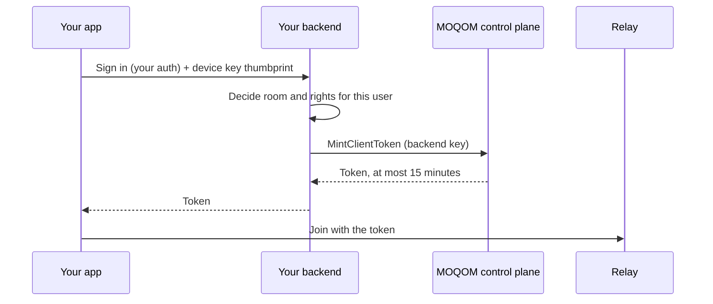

An API key is how your servers prove they are your tenant. Every key looks like
`mqk_<16 hex>_<secret>`: the ID is the part before the second underscore, and the secret is 256
random bits that MOQOM stores only as a hash. The fixed `mqk_` prefix makes a key easy to
recognise if it is pasted somewhere it shouldn't be, such as code pushed to a public repository;
tools that search code for leaked passwords can be set to look for it.

## Two kinds

| Kind | Used by | Can do | Cannot do |
| --- | --- | --- | --- |
| `backend` | Your backend | Everything for your tenant: rooms, moderation, minting tokens, billing, keys | — |
| `relay` | A [self-hosted relay](/guides/self-hosting/) | Report usage with [`POST /v1/usage`](/reference/usage-api/) | Anything else. Billing and key routes answer `401`, and the control-plane gRPC API refuses it |

A backend key is an owner of its tenant. Treat it like a database password. A relay key can
only report usage, so a leaked one cannot be used to take over rooms or read billing.

Your first backend key, named `default`, comes from [`POST /v1/signup`](/reference/billing-api/#post-v1signup).
Issue more from the console at [moqom.cloud/account](https://moqom.cloud/account/) or with
[`POST /v1/keys`](/reference/billing-api/#post-v1keys):

```sh
curl -sS https://api.moqom.cloud/v1/keys \
  -H "Authorization: Bearer $MOQOM_API_KEY" \
  -H 'Content-Type: application/json' \
  -d '{"name":"prod-backend","kind":"backend"}'
```

One key per environment or service (`prod-backend`, `staging-backend`, `relay-us-east-1`) makes
rotation and revocation affect one thing at a time.

## Shown once

The plaintext key appears only in the response that created it. MOQOM keeps a hash, so a lost
key cannot be recovered or shown again, only revoked and replaced.
[`GET /v1/keys`](/reference/billing-api/#get-v1keys) lists IDs, names, kinds and dates, never
secrets. Put the key in your secret manager as soon as you get it.

## Never ship a key in an app

A key inside an iOS, Android, desktop or web build can be extracted by anyone who installs it,
and a backend key extracted that way can mint tokens, moderate rooms and spend your credit.
Keys belong on servers you control.

Devices join with **participant tokens**, which your backend mints per user, per device and per
room:



- The token names one user, one device and one room, with exactly the rights you grant.
- It lasts at most 15 minutes, and the client SDK renews it through your backend.
- It is bound to the device's key, so a token copied off one device does not work on another.

See [Backend: Go](/guides/backend-go/#mint-a-token) or [Backend: Rust](/guides/backend-rust/#mint-a-token)
for the call, and the [5-minute quickstart](/getting-started/quickstart/) for the full flow.
No key of any kind ever ships in an app. For an app without a backend,
[Getting a token onto a device](/reference/device-tokens/) covers the reference token server and
Apple sign-in hosted by MOQOM; neither puts a secret on the device.

## Rotate with an overlap

[`POST /v1/keys/{id}/rotate`](/reference/billing-api/#post-v1keysidrotate) issues a replacement
with the same name and kind, and schedules the old key's revocation instead of revoking it now.
Both keys work during the overlap, so you can roll the new one out with no gap.

```sh
curl -sS -X POST https://api.moqom.cloud/v1/keys/0a1b2c3d4e5f6a7b/rotate \
  -H "Authorization: Bearer $MOQOM_API_KEY" \
  -d '{"overlap_seconds": 3600}'
```

| | |
| --- | --- |
| Default overlap | 86,400 s (24 hours) |
| Longest overlap | 604,800 s (7 days) |
| During the overlap | `GET /v1/keys` shows the old key with `retires_at` |
| After it | The old key shows `revoked_at` and is refused |

A rotation that works:

1. Rotate. Store the new key from the response; it is shown once.
2. Deploy the new key to every service that used the old one.
3. Watch for `401`s from anything you missed before `old_key_retires`.
4. Optionally revoke the old key early once nothing uses it.

You can rotate the key the request is authenticated with. Live sessions are never affected:
participant tokens do not depend on the key that minted them.

## Revoke

[`DELETE /v1/keys/{id}`](/reference/billing-api/#delete-v1keysid) revokes a key immediately.
Use it when a key has leaked; otherwise rotate.

- You cannot revoke the key the request is authenticated with (`400`). Issue or rotate first,
  then revoke with the new key.
- Revoking your **last working backend key** would stop all video: your backend could no longer
  mint tokens, new sessions would be refused, and live ones would end within 15 minutes when
  their tokens can't renew. Revoking the last relay key stops your relays reporting usage. Both
  are refused with `409` and `"code": "would_stop_service"` unless you add
  `?confirm=stop-service`.

If a backend key leaks: rotate it with a short overlap (or issue a new key and revoke the leaked
one at once), deploy the new key, then check the ledger with
[`GET /v1/billing`](/reference/billing-api/#get-v1billing) for usage you don't recognise.
