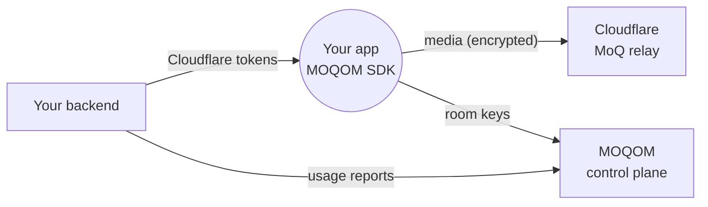

The MOQOM SDK can carry media over **Cloudflare's MoQ relays** instead of MOQOM's. Cloudflare
runs them in over 330 cities.

:::caution[Cloudflare's MoQ relays are in beta]
Cloudflare offers its MoQ relays as a **free beta**. Its relays speak [MoQ Transport](https://datatracker.ietf.org/doc/draft-ietf-moq-transport/)
**draft-16**, published 13 January 2026. The current draft is **draft-22**, published
1 October 2026, six revisions later. They support only part of
that draft: see [What Cloudflare supports](#what-cloudflare-supports). Cloudflare can change
the service, its limits or its price when the beta ends. This page reflects Cloudflare's
documentation as of October 2026.
:::

The trade-off is simple:

- **Cloudflare relays:** free during the beta and global, but with a subset of draft-16 and
  none of MOQOM's relay features.
- **MOQOM relays,** cloud or [self-hosted](/guides/self-hosting/): the current draft
  (draft-22, with draft-19, published 6 July 2026, for older clients) and every MOQOM feature.

Your app code is the same either way. Only the endpoint and the token change.

## Why use the MOQOM SDK with Cloudflare

Cloudflare provides relays, not a client SDK. Its getting-started guide uses the open-source
`moq-rs` command-line tools (`moq-pub` and `moq-sub`). Everything else on the client side is
yours to build: capture, encoding, packaging, reconnects, encryption and rooms.

The MOQOM SDK is a complete client that you drop in:

- the same API on Cloudflare and on MOQOM relays, so switching is a one-line change;
- the draft that each relay speaks, chosen automatically;
- end-to-end encryption ([SFrame](https://www.rfc-editor.org/rfc/rfc9605) with [MLS](https://www.rfc-editor.org/rfc/rfc9420) room keys) on top of Cloudflare's relays;
- reconnecting when the network changes, and clear errors for anything Cloudflare doesn't
  support.

## How it works



There are four pieces:

1. **Media goes through Cloudflare.** Your app connects to Cloudflare's relay and publishes or
   subscribes as usual.
2. **End-to-end encryption still works.** The SDK encrypts every payload on the device, so
   Cloudflare forwards data it can't read. Room keys still come from MOQOM.
3. **Your backend issues Cloudflare tokens.** Cloudflare checks its own tokens, not MOQOM's.
   Your backend creates them with your Cloudflare account and hands them to the app.
4. **Your backend reports usage to MOQOM.** MOQOM can't see Cloudflare's traffic, so you report
   it, the same way a self-hosted relay does.

The SDK detects a Cloudflare endpoint and speaks Cloudflare's draft automatically. You don't
handle draft versions yourself.

## Set it up

### 1. Create a relay on Cloudflare

Do this in the Cloudflare dashboard under **Media › Realtime › MoQ Relay**, or with the API:

```sh
curl -X POST "https://api.cloudflare.com/client/v4/accounts/$CF_ACCOUNT_ID/moq/relays" \
  -H "Authorization: Bearer $CF_API_TOKEN" \
  -H "Content-Type: application/json" \
  -d '{"name": "my-app-prod"}'
```

Each relay is private to itself, so create one per app or environment. Cloudflare shows token
secrets only once: save them straight to your secret store.

### 2. Hand out tokens from your backend

Never put your Cloudflare API token in the app. Create relay tokens on your backend:

```sh
curl -X POST "https://api.cloudflare.com/client/v4/accounts/$CF_ACCOUNT_ID/moq/relays/$CF_RELAY_ID/tokens" \
  -H "Authorization: Bearer $CF_API_TOKEN" \
  -H "Content-Type: application/json" \
  -d '{"operations": ["subscribe"], "expires": "2026-10-07T00:00:00Z", "label": "viewers"}'
```

- Give viewers **subscribe-only** tokens, and give each publisher its own publish token.
- A relay holds at most **10 tokens**, so viewers share one short-lived token that you rotate.
- Keep expiry short. Tokens travel in the connection path, so they can appear in Cloudflare's
  logs.
- For encrypted rooms, the app also needs its usual MOQOM participant token, which fetches the
  room keys. So the app holds two tokens: Cloudflare's for media, and MOQOM's for keys.

### 3. Point the SDK at Cloudflare

Swift:

```swift
let session = try await MoqtTransport.network().connect(
    to: .cloudflare(token: cloudflareToken),
    credentials: credentials
)
```

Everything after `connect` is the same as on a MOQOM relay. The SDK redacts the token when the
endpoint is logged.

To test from a terminal, use the `moqom` CLI. It reads the token from an environment variable,
which keeps it out of the process list:

```sh
export MOQOM_CF_DEMO_TOKEN='<a subscribe token>'
moqom cloudflare sub --namespace my-namespace --count 20
```

### 4. Report usage

Create a relay key once, in the dashboard or with `POST /v1/keys` and `"kind": "relay"`. Then
report usage from your backend with `"hosting": "cloudflare"`:

```sh
curl -sS https://api.moqom.cloud/v1/usage \
  -H "Authorization: Bearer $MOQOM_RELAY_KEY" \
  -H 'Content-Type: application/json' \
  -d '{
    "hosting": "cloudflare",
    "records": [{
      "id": "cf:2026-10-06T09:15:00Z:bea",
      "room": "live/42",
      "participant": "bea",
      "role": "broadcast_audience",
      "tier": "full_hd",
      "seconds": 60,
      "egress_bytes": 104857600,
      "ingress_bytes": 0
    }]
  }'
```

The records and limits follow the [usage reporting API](/reference/usage-api/). Each record's
`id` makes it safe to resend. Keep the relay key on your backend, never in the app.

### 5. Try it without an account

Cloudflare publishes a free subscribe-only demo token for the namespace `bbb` on its
[demo streams page](https://developers.cloudflare.com/moq/demo-streams/):

```sh
export MOQOM_CF_DEMO_TOKEN='<token from the demo streams page>'
moqom cloudflare sub --namespace bbb --count 10
```

If objects arrive, your client works. Publishing needs a relay of your own, from step 1.

## What Cloudflare supports

According to Cloudflare's [feature matrix](https://developers.cloudflare.com/moq/feature-matrix/)
(updated 31 July 2026), its draft-16 relays support:

- **Supported:** SETUP, SUBSCRIBE and UNSUBSCRIBE, PUBLISH, namespace subscriptions
  (SUBSCRIBE_NAMESPACE and UNSUBSCRIBE_NAMESPACE), and TRACK_STATUS.
- **Partly supported:** request limits (MAX_REQUEST_ID, REQUESTS_BLOCKED). The relay doesn't
  raise the limit by itself when a client is blocked.
- **Not supported:**
  - FETCH, so there's no catch-up from the relay's cache;
  - SUBSCRIBE_UPDATE, so there's no pause, resume or priority change;
  - GOAWAY, so there's no graceful migration;
  - PUBLISH_ERROR and TRACK_STATUS_ERROR.

Authentication is a token in the connection URL, with at most 10 tokens per relay. In-band
tokens (C4M, Privacy Pass) are planned, not available. Cloudflare is testing draft-18 but hasn't
deployed it globally.

Compared with MOQOM's relays, Cloudflare is missing two kinds of thing:

- **Newer drafts:** MOQOM's relays run draft-22. Anything the working group added or changed
  after draft-16 isn't available on Cloudflare. The SDK hides the wire differences, but not the
  missing features.
- **MOQOM relay features:** admission, moderation, metering, recording and adaptation run on
  MOQOM's relays, so none of them run on Cloudflare.

## Closing the gap in the standard

Some of what Cloudflare lacks is simply a newer draft. Some of it isn't in any draft yet, so
we've proposed improvements to the IETF MoQ specification to help MoQ spread beyond any one
platform:

- **`EXPIRED_AUTH_TOKEN` for subscriptions**, so a relay can tell a subscriber to renew its
  token rather than end the subscription. Filed as
  [issue #1969](https://github.com/moq-wg/moq-transport/issues/1969) and
  [pull request #1970](https://github.com/moq-wg/moq-transport/pull/1970).
- **A [hop limit for relays](/specs/relay-hops-proposal/)** that stops subscriptions looping
  between relays.
- **[More for draft-23](/architecture/draft-23-proposals/):** separating property types from
  parameter types, and shared test vectors.

Until the working group adopts these and other platforms implement them, MOQOM is the first and
only platform that ships them. What MOQOM adds on top of the standard, including post-quantum
end-to-end encryption, device-bound tokens, point-to-point calls and relay-side adaptation, is
patent pending.

## Cloudflare and MOQOM relays compared

| Feature | Cloudflare | MOQOM relays |
| --- | --- | --- |
| [MoQ Transport](https://datatracker.ietf.org/doc/draft-ietf-moq-transport/) draft | 16 (18 in testing) | 22 and 19 |
| Relay pricing | Free during Cloudflare's beta | [MOQOM pricing](/billing/pricing/) |
| Client SDK from the relay provider | No | Yes |
| Publish and subscribe | Yes | Yes |
| End-to-end encryption | Yes | Yes |
| Late join from cache (catch-up) | No: viewers start at the next group | Yes |
| Pause, resume, priority changes | No | Yes |
| Renewing a token mid-session | No: reconnect with a new token | Yes |
| Graceful relay migration | No | Yes |
| Admission, kick and ban, spend limits | No | Yes |
| Recording, events, relay-side metering | No | Yes |
| Layer and bitrate adaptation at the relay | No | Yes |
| Peer-to-peer calls | No | Yes |

When you call something Cloudflare can't do, such as `fetch`, the SDK throws
`MoqomError.unsupportedByRelay` instead of sending it.

## Pricing

| When | Price |
| --- | --- |
| Usage reported before 1 November 2026 (UTC) | Free trial |
| From November 2026 | First 1,000 participant-minutes each month free, then the [self-hosted fee](/billing/self-hosted/) of $0.05/GiB |

- Cloudflare's own charges are between you and Cloudflare. Its relays are free during its beta.
- These 1,000 minutes are separate from the 1,000 free peer-to-peer minutes.
- The trial counts by when a report **arrives**, so report at least daily.

## Troubleshooting

| What you see | Likely cause |
| --- | --- |
| The handshake fails with "no known protocol" | Wrong host. Use `draft-16.cloudflare.mediaoverquic.com`. |
| The session closes right after connecting, with a protocol error | The Cloudflare token is missing, expired or has the wrong role |
| "Track not found" | The namespace doesn't exist on this relay |
| "Internal error" on a subscribe | The namespace exists, but the track doesn't |
| `401` from `/v1/usage` | The key isn't a relay key, or it was revoked |
| `400` mentioning `hosting` | A misspelt `hosting` value, or the report wasn't sent with a relay key |
