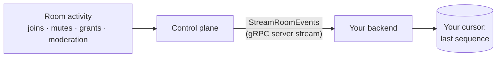

MOQOM gives your backend two feeds of truth:

- **Room events** — a durable, ordered gRPC server stream of everything that happens in a room
  or across your tenant (`Events.StreamRoomEvents`). Events are stored before they're sent, so
  your backend can go away and come back without missing one.
- **Billing state** — your balance, admission status and recent ledger entries over REST
  (`GET /v1/billing`).

:::note[Outbound HTTP webhooks]
MOQOM does not currently push HTTP webhooks to your servers. Use the room event stream for room
activity and poll `GET /v1/billing` for credit. The `POST /v1/stripe/webhook` route you may see
in the API is MOQOM's own receiver for Stripe and is not for customer use.
:::

## Room events



| Event kind | Body |
| --- | --- |
| `PARTICIPANT_JOINED` | `participant`, `first_device` (true for the person's first device) |
| `PARTICIPANT_LEFT` | `identity`, `was_removed`, `code`, `last_device` |
| `PRESENCE_CHANGED` | `identity`, `from`, `to` (`connected`, `reconnecting`, `away`, `backgrounded`, `left`); see [Presence](/guides/presence/) |
| `GRANTS_CHANGED` | `identity`, `from`, `to` |
| `MUTE_CHANGED` | `identity` and the full mute state: `self_muted`, `forced_muted_for_everyone`, `forced_muted_for_audience` |
| `SPOTLIGHT_CHANGED` | `identity` (unset when cleared) |
| `PUBLISH_STARTED` / `PUBLISH_STOPPED` | `identity`, `track`, `started` |
| `WATCHDOG_CHANGED` | `watchdog`, `detached` |
| `LIFECYCLE_CHANGED` | `from`, `to`, `acting_host` |
| `MODERATION_APPLIED` | the full `ModerationEntry` |

### Durable event streams

Every event is written to the control plane's database first and streamed second. A consumer
that was away, restarted or lost its connection reads what it missed from the stored history,
then switches to live delivery with no gap and no duplicate at the seam.

- **Durable:** stored before delivery, so nothing depends on your backend being connected at the
  moment it happened.
- **At-least-once, ordered per room.**
- Each event carries a **`sequence`** that is contiguous within its room and never reused. A gap
  means you missed something.
- Pass `after_sequence` to resume exactly where you stopped. Zero starts at the present — right
  for a dashboard, wrong for anything that must not miss an event.
- A server restart closes the stream; reconnect **from your cursor**.
- Each event has `at` and a `timecode` (instant + uncertainty + clock trust). Within one room,
  order by `sequence`, not by time.

Follow one room (`room` set) or every room in the tenant (`room` empty — the right choice for a
moderation queue). Filter with `kind`.

Code: [Go](/guides/backend-go/#follow-a-room) · [Rust](/guides/backend-rust/#follow-a-room).

## Billing state

```sh
curl -sS https://api.moqom.cloud/v1/billing -H "Authorization: Bearer $MOQOM_API_KEY"
```

```json
{
  "tenant": {
    "id": "t_3f9a0c1d2e4b5a69",
    "name": "Example Inc",
    "email": "dev@example.com",
    "status": "active",
    "has_card": true,
    "auto_top_up": {
      "enabled": true,
      "below": { "micros": 10000000, "display": "$10.000000" },
      "amount": { "micros": 50000000, "display": "$50.000000" }
    },
    "created_at": "2026-10-01T17:03:11Z"
  },
  "balance": { "micros": 41237500, "display": "$41.237500" },
  "admitted": true,
  "recent": [
    { "kind": "usage", "amount": { "micros": -3980, "display": "-$0.003980" }, "capped": true, "reference": "live/42", "at": "2026-10-06T09:16:02Z" },
    { "kind": "top_up", "amount": { "micros": 50000000, "display": "$50.000000" }, "reference": "pi_3Q…", "detail": "auto_top_up", "at": "2026-10-05T22:40:19Z" }
  ]
}
```

- **`admitted`** — whether new sessions and tokens are being admitted right now. Alert on
  `false`.
- **`balance`** — prepaid credit remaining.
- **`recent`** — up to the 50 most recent ledger entries.
- **`last_top_up_error`** — present on `tenant` when an automatic top-up failed (for example, a
  declined card).

### Ledger entry kinds

| `kind` | Sign | Meaning |
| --- | --- | --- |
| `top_up` | + | A payment credited (checkout or automatic top-up). Activates a `pending` tenant. |
| `usage` | − | Usage charged. `capped: true` when a self-hosted fee was held to the hosted rate. `reference` is the room. |
| `refund` | − | A refunded payment, removed from credit. |
| `signup_credit` | + | Promotional credit granted at signup. |
| `adjustment` | ± | A manual correction by MOQOM. |

### Recommended alerting

1. Poll `GET /v1/billing` every few minutes.
2. Alert when `admitted` is `false` or `balance` drops below your threshold.
3. Turn on [auto top-up](/billing/top-ups/) so you rarely reach zero.
4. Watch `last_top_up_error` for card failures.

When credit runs out, **`MintClientToken` returns `FailedPrecondition`**, so no new session
can start; moderation keeps working throughout.
