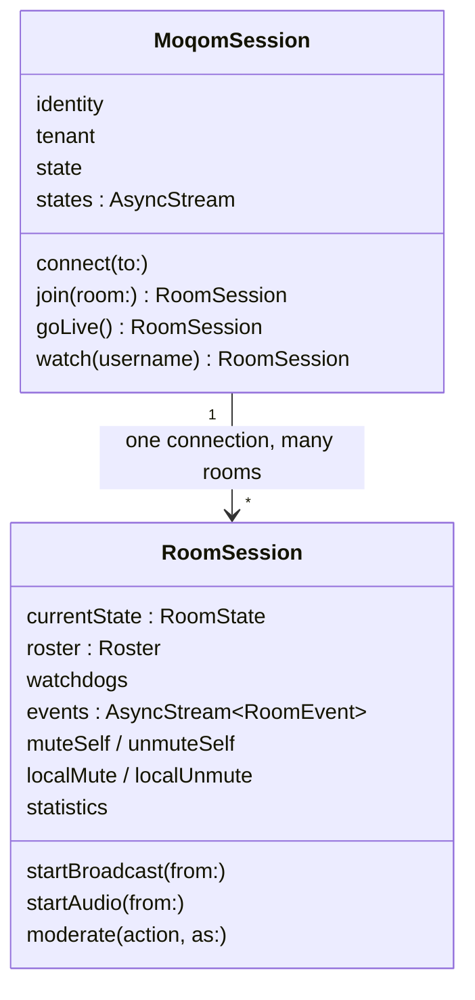
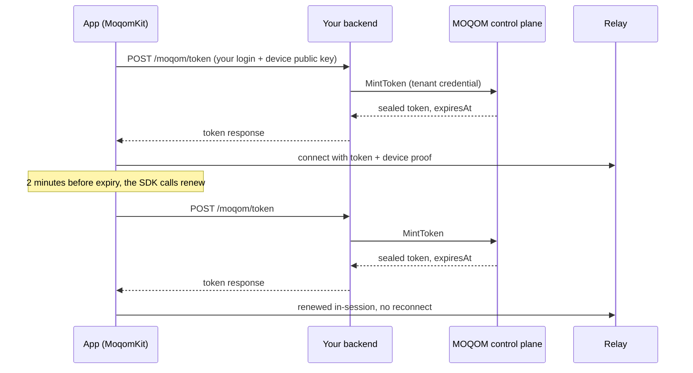

`MoqomKit` is the Apple-platform client SDK. It is **available now** for iOS, iPadOS, macOS,
visionOS and tvOS, and ships as a Swift package with a binary core.

| | |
| --- | --- |
| Platforms | iOS, iPadOS, macOS, visionOS, tvOS **26** and later |
| Language | Swift 6, complete strict concurrency |
| Transport | [QUIC](https://www.rfc-editor.org/rfc/rfc9000) and TLS 1.3 through MOQOM's own Rust library (rustls with AWS-LC), shipped as an XCFramework inside the package; ML-KEM-1024 key exchange only |
| Media | VideoToolbox (H.264 / HEVC), Opus audio |
| Licence | Apache-2.0 for the package source; binary core under its own licence |

## Install

```swift
// Package.swift
.package(url: "https://github.com/moqom-cloud/moqom-swift", from: "0.1.0")

// target
.product(name: "MoqomKit", package: "moqom-swift")
```

`MoqomKit` re-uses types from `MoqomCore` (identity, names, frame formats), so most files
import both:

```swift
import MoqomKit
import MoqomCore
```

The SDK never prompts for camera or microphone permission on its own. Request access in your UI
where you can explain why, before starting capture.

## The object model



- **`MoqomSession`** — one connection from this device to a relay. Rooms and personal channels
  hang off it; moving between rooms never opens a new connection.
- **`RoomSession`** — a joined room: roster, state, events, publishing, moderation.

## Device identity

Every device has a key, generated on the device and never exported:

```swift
let deviceKey = try DeviceKey.installed()   // Secure Enclave where available, Keychain otherwise
deviceKey.jwk                                 // the public key, sent when asking for a token
deviceKey.thumbprint                          // its RFC 7638 thumbprint
```

Your backend derives the thumbprint from the public key and passes it to `MintClientToken`, which
binds the token to this device. Use the same thumbprint for the participant's `DeviceID`:

```swift
let identity = ParticipantIdentity(
    username: try Username("alice"),
    device: try DeviceID(thumbprint: deviceKey.thumbprint)
)
```

`DeviceKey.ephemeral()` creates a throwaway key for tests and previews.

## Connect

```swift
let session = MoqomSession(
    transport: MoqtTransport.network(),          // system QUIC
    credentials: DeviceCredentials(
        identity: identity,
        token: issued.token,                     // from your backend
        deviceKey: deviceKey,
        expiresAt: issued.expiresAt,
        renew: { try await myBackend.freshToken() }  // returns IssuedToken
    ),
    tenant: TenantID("t_3f9a0c1d2e4b5a69")
)

try await session.connect(to: RelayEndpoint(host: "relay.example.moqom.cloud"))
```

### Tokens and renewal

Tokens live at most 15 minutes. Provide `expiresAt` and a `renew` closure and the SDK fetches
a replacement before expiry and keeps the session running — no reconnect, no interruption. If you
pass no `renew` closure, the session ends with `.tokenExpired` when the token runs out.

`IssuedToken` carries the token, its expiry, and the **username actually minted** (usernames are
normalised server-side; display this one, not the one you asked for). It also carries the
`tenant`, `room`, the full `device` thumbprint, what the token lets you `publish` (`mayPublish`
for a quick check) and the room's `direct` policy. Read them from `IssuedToken`, never from the
token: every MOQOM token is [sealed](/security/libraries/token/#sealed-tokens), so to the app it
is opaque bytes.

#### Who does what

The SDK owns the timing: it calls `renew` two minutes before expiry, retries every 15 seconds if
the call fails, and swaps the new token in without reconnecting. Your backend owns the minting,
because minting needs your tenant credential and that never ships in an app. The same endpoint
serves the first token and every renewal, so there is nothing to schedule on the server. This is
identical on MOQOM Cloud and self-hosted; only the control-plane address your backend dials
changes.



**In the app**, `TokenService` calls your route and returns an `IssuedToken`. One function serves
both the first token and `renew`:

```swift
import MoqomKit

struct MyBackend {
    let deviceKey: DeviceKey
    let room: String

    /// Calls your server, authenticated with your app's own sign-in. No MOQOM key is in the app.
    func freshToken() async throws -> IssuedToken {
        let service = TokenService(
            url: URL(string: "https://api.example.com/moqom/token")!,
            authorization: try await Account.current.accessToken()
        )
        return try await service.token(username: "alice", room: room, device: deviceKey)
    }
}

let backend = MyBackend(deviceKey: deviceKey, room: "live/42")
let issued = try await backend.freshToken()

let session = MoqomSession(
    transport: MoqtTransport.network(),
    credentials: DeviceCredentials(
        identity: identity,
        token: issued.token,
        deviceKey: deviceKey,
        expiresAt: issued.expiresAt,      // tells the SDK when to renew
        renew: { try await backend.freshToken() }
    ),
    tenant: TenantID("t_3f9a0c1d2e4b5a69")
)
```

**On your server**, the route checks your user, derives the thumbprint from the device's public
key, mints with [moqom-go](/guides/backend-go/#mint-a-token), and answers with the
[token response](/reference/device-tokens/#the-token-response) `TokenService` reads. The complete
route is in [Getting a token onto a device](/reference/device-tokens/#1-your-backend-mints); its
core is:

```go
thumbprint, err := req.Key.Thumbprint() // derived here, never taken from the device
// … check the session and your own rules for req.Room …
token, err := client.MintToken(r.Context(), moqom.TokenRequest{
    Username:         user.ID,
    DeviceThumbprint: thumbprint,
    Room:             req.Room,
    Publish:          moqom.PublishCamera,
})
```

A renewal can't raise rights: the relay accepts a renewed token only if it names the same user,
device and permissions as the one it replaces. To promote someone mid-session, see
[Changing role without reconnecting](#changing-role-without-reconnecting).

No long-lived secret ships in the app, so there is no way for the app to mint for itself. If you
have no backend yet, run the open-source reference token server with Sign in with Apple, or let
MOQOM host Apple sign-in for your tenant, App Attest included. Both return the same response, so
the app code above doesn't change: see
[Getting a token onto a device](/reference/device-tokens/).

### Session state

```swift
for await state in session.states {
    switch state {
    case .idle, .connecting: break
    case .established: showConnected()
    case .reconnecting: showBanner("Reconnecting…")
    case .away: showBanner("Connection lost")
    case .closed(let reason): handleEnd(reason)
    }
}
```

`.closed` carries why the session ended:

| `TerminalEvent` | Meaning |
| --- | --- |
| `.moderated(code:)` | Removed by a moderator. `code` is a [moderation code](/guides/moderation/#moderation-codes) you can show to the user. |
| `.hostEnded` | The host ended the room or broadcast. |
| `.networkFailure` | The network went away and did not come back within the reconnect window. |
| `.tokenExpired` | The token lapsed and could not be renewed. |

Reconnection is automatic. While a session is reconnecting, other participants see your
presence as *reconnecting* rather than *left*, and on return your subscriptions, mutes, grants
and stage position are restored.

## Join a room

```swift
let room = try await session.join(room: RoomID("demo"))
```

Personal channels — one user broadcasting under their own name, without a room record:

```swift
let mine = try await session.goLive()                       // publish on my channel
let theirs = try await session.watch(try Username("bea"))   // watch someone else's
```

## Publish

Publishing is always an explicit act by the participant. A grant (permission to publish video)
never starts a camera.

Every room requires [end-to-end encryption](/guides/e2ee/), so pass a `keyDelivery` or set the
room key first; without it both calls below throw `MoqomError.encryptionRequired`.

```swift
await room.useEncryption(RoomEncryption.sharedKey(roomKey, keyID: 1))

// Camera → video
let camera = try CameraSource(
    format: CaptureFormat(size: PixelSize(width: 1280, height: 720), frameRate: 30),
    position: .front
)
camera.start()
let broadcast = try await room.startBroadcast(from: camera)
await broadcast.start()

// Microphone → audio, independently of video
let microphone = try MicrophoneSource()
try microphone.start()
let audio = try await room.startAudio(from: microphone)
await audio.start()

// Later
await room.stopBroadcast()
await room.stopAudio()
```

Pass `backstage: true` to either call to publish backstage — visible to hosts, not to the
audience — and go live later without a new token.

Any `FrameSource` can be published: the camera, a RealityKit / Metal scene (`SceneCapture`), or
your own frames.

### Muting yourself

```swift
await room.muteSelf(.audio)
await room.unmuteSelf(.audio)
room.selfMuted          // what you have chosen not to send
```

Self-mute is reported to the room so other clients can show it.

## Subscribe and watch

Joining a room subscribes you to it: everyone on stage appears in the roster, including people
who arrive later. Tell the SDK what you are drawing and how big, and it subscribes at a suitable
quality for each tile:

```swift
await room.updateLayout([
    bea: RenderBox(width: 390, height: 220, scale: 3),
    carol: RenderBox(width: 120, height: 68, scale: 3),
])
```

Off-screen participants keep their audio. Rendering is provided by the SDK's binary core; for
grids, `MoqomGalleryView` lays out tiles and follows the active speaker.

To stop hearing or seeing one person **just for yourself**:

```swift
await room.localMute(bea, .audio)
await room.localUnmute(bea, .audio)
```

A local mute costs nothing: the media simply stops being sent to you.

### One picture in several places

To show the same participant in two places at once, say a tile and the stage, take a presenter
from their renderer rather than making a second one. The frame is decoded once and every layer
draws the same hardware surface, so a second view costs no copy and no extra decoder:

```swift
let stage = renderer.addPresenter()
stageView.layer.addSublayer(stage.layer)
// later
renderer.remove(stage)
```

A presenter shows the current picture straight away if the renderer is already decoding once;
otherwise it starts at the next keyframe. Set `renderer.mirrorsInstantly = true` on any renderer
you expect to mirror, so it always is.

### A feed of live rooms

`RoomFeed` keeps the rooms either side of the one on screen joined, subscribed at a small size and
decoding, so a room is already playing as it scrolls in, and opening it shows the picture with no
gap:

```swift
let feed = RoomFeed(session: session, rooms: roomIDs)
feed.focus(on: index)                     // call as the visible card changes

cell.layer.addSublayer(feed.entry(for: room)!.renderer.layer)

let live = try await feed.open(room)      // the feed stops managing it
let hero = feed.entry(for: room)!.renderer.addPresenter()
// ...
feed.release(room)                        // back to the feed when the room closes
```

The focused room is subscribed at full-screen size and its neighbours at a smaller one
(`feed.options`); one room past the window is kept so scrolling back and forth doesn't rejoin.
Preloaded rooms are joined **relay-only**, so scrolling past a room never tells anyone in it your
IP address, and a preloading viewer publishes nothing into the room. Each preloaded room is a
viewer session and is metered like one; widen the window
(`ahead`, `behind`) only as far as your feed needs.

### Raw media

For on-device transcription, captioning or classification, the SDK hands out decoded media:

```swift
let beaVideo = await room.tapVideo(from: bea, policy: .classification) // keyframes only
let beaAudio = await room.tapAudio(from: bea, policy: .transcription)
let myMic = await room.tapCapturedAudio(policy: .transcription)
```

In encrypted rooms taps receive plaintext, because they run on the device that holds the key. If
you send tapped media anywhere, disclose it — attaching a [watchdog](/getting-started/concepts/#watchdogs)
is the mechanism for that. [AI agents](/guides/ai-agents/) covers classifiers, agents and AI hosts
with RealityKit avatars.

## Room state

`room.currentState` is a snapshot; `room.events` is the stream of changes.

```swift
let state = await room.currentState
state.roster            // participants on stage and in the room
state.backstage         // participants waiting backstage
state.broadcasters      // who is publishing
state.stage             // spotlight, stage lock, invitations
state.lifecycle         // live, ended, …
state.isRecording       // a recording watchdog is attached
state.participantCount
```

Each `Participant` carries `username`, `device`, `grants`, `role` (display label), `presence`,
`mute` (self, forced-for-everyone, forced-for-audience) and `isSpotlighted`. For a "who's here"
list with join and leave notices, see [Presence](/guides/presence/).

```swift
for await event in room.events {
    switch event {
    case .participantJoined(let p):        add(p)
    case .participantLeft(let who, let why): remove(who, why)   // .left, .evicted, .timedOut, .connectionLost
    case .presenceChanged(let who, let presence): update(who, presence)
    case .muteChanged(let who, let mute):  update(who, mute)
    case .grantsChanged(let who, let grants): update(who, grants)
    case .spotlightChanged(let who):       spotlight(who)
    case .stageChanged(let stage):         render(stage)
    case .watchdogChanged(let watchdogs):  showRecordingBadge(watchdogs.isRecording)
    case .lifecycleChanged(let lifecycle): handle(lifecycle)
    case .captureRestricted(let held, _):  disable(held)        // a moderator force-muted you
    default: break
    }
}
```

## Moderation callbacks

When a moderator acts on **you**, the room tells you, and the SDK enforces it:

- **Force-muted** — `.captureRestricted(held:resumable:)` names the media you may not send.
  `room.forceMuted` reflects it. When it is lifted, `room.resumableAfterForceMute` lists what you
  may turn back on, and `room.resumeAfterForceMute()` does so — the SDK never re-enables your
  camera or microphone without you.
- **Grants changed** — `.grantsChanged` for your own identity. A demotion takes effect
  immediately; a promotion makes new actions available.
- **Taken off the stage** — `.publishingRevoked(kinds)`. A demotion ended what you were
  publishing; the SDK has already turned the camera and microphone off. You are still in the room
  and still watching — update the interface, nothing else.

### Changing role without reconnecting

When your backend promotes a participant, it mints a token for the new role. Present it on the
room the app is already in:

```swift
let issued = try await myBackend.tokenForNewRole()      // IssuedToken
try await room.updateCredential(issued, renewingWith: { try await myBackend.freshToken() })

// Promoted: go live on the same session when the user chooses to.
try await room.startBroadcast(from: camera)
```

Nothing reconnects; playback and the roster carry on. Pass `renewingWith` if your existing
`renew` closure would mint the old role, otherwise the next renewal hands it back. The token must
be for the same user, on the same device, in the same room, and bound to the device key.
- **Kicked, banned, or the room closed** — the session ends with `.closed(.moderated(code:))`
  or `.closed(.hostEnded)`. Show the user something true; the code says why.

### Moderating from the client

Participants who hold capabilities can moderate from the app:

```swift
try await room.moderate(.forceMute(bea, .audio, until: nil), as: myGrants)
try await room.moderate(.kick(bea), as: myGrants)
try await room.moderate(.banFromRoom(bea, until: Date().addingTimeInterval(86_400)), as: myGrants)
try await room.moderate(.spotlight(bea), as: myGrants)
try await room.moderate(.lockStage(true), as: myGrants)
```

The SDK checks the capability and the strict-superset rule locally so you can disable buttons
without a round trip; the relay and control plane enforce it regardless. For anything audited or
automated, prefer moderating [from your backend](/guides/moderation/).

## Stage invitations

```swift
// Host invites a viewer up, offering camera rights for 30 seconds.
let invite = try await room.invite(try Username("dan"), offered: .camera, expiresAfter: .seconds(30))

// A viewer asks to come up.
let request = try await room.requestStage(offered: .camera)

// Either side resolves it.
try await room.accept(invite.id)
try await room.decline(invite.id)
try await room.cancel(request.id)
```

Accepting grants publish rights and starts nothing — the guest still chooses to go live. When the
promotion is backed by a new token from your backend, present it with
[`updateCredential`](#changing-role-without-reconnecting); the guest stays on the same session.

## Statistics

```swift
let snapshot = await room.statistics              // one consistent snapshot
for await s in await room.statistics(every: .seconds(1)) { render(s) }
```

`RoomStatistics` reports the link, your uplink, and per-participant receive quality, read at one
instant so the numbers agree with each other.

## Logging

The SDK is silent by default. Pass a `MoqomLogger` to `MoqomSession` to route its diagnostics
into your own logging. Identities are hashed in logs and payloads are only ever written as byte
counts.

## Invitation links

A `moqom://join` link tells an app where to connect, and carries no secret:

```text
moqom://join?relay=host:port&cert=<hash>&tokens=<token server URL>&mls=<host:port>&mlscert=<hash>&room=<name>
```

`RelayInvitation` reads it: the relay and its certificate hash, the `https` token server to
sign in with, the MLS key service and its certificate hash, and the room. The app still signs the
person in and gets its own token. Links from older builds with `token=` or `key=` parameters
still open, but those parameters are ignored. The format is in
[Getting a token onto a device](/reference/device-tokens/#invitation-links).

Key delivery is configured on its own, not derived from `TokenService`: create
`HTTPMLSDelivery(endpoint:certificateHashes:)` with the link's `mls` address and `mlscert` hash,
and pass it as `keyDelivery`. See [Managed keys](/guides/e2ee/#managed-keys-swift).

## Sample app

`Samples/MoqomRoom` in the SDK repository is a complete SwiftUI room app: join screen, gallery,
stage, mutes, moderation and statistics. It signs people in with Sign in with Apple, from a
button in Settings, against the [reference token server](/reference/device-tokens/#2-the-reference-token-server),
and keeps the enrollment in the Keychain. Configure it with your own relay endpoint and token
server in `Local.xcconfig` (copy `Local.xcconfig.example`).
