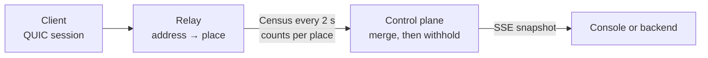

The console page at `moqom.cloud/account/live/` shows a world map of your tenant's active
sessions, updated every two seconds, with counts per place. A side panel shows the number of
active sessions, publishers and viewers, rooms, and sessions per relay region.

The same data is available to your backend over HTTP.

## How a location is derived



1. A relay resolves the address a session connected from to a place, using a
   GeoLite2-City compatible database. A place is an ISO country code, a subdivision code, an
   English city name, and a latitude and longitude rounded to whole degrees (about 110 km).
2. The relay keeps the place, not the address, for as long as the session lives. It discards it
   when the session ends.
3. Every two seconds each relay sends the control plane a census: per tenant, the number of
   sessions in each place, the number publishing, and the number it could not place. The census
   contains no addresses, session IDs, usernames, devices or room names.
4. The control plane merges the latest census from every relay and applies the disclosure rule
   below before anything is returned.

Nothing is written to disk or a database at any step. Each census replaces the previous one from
the same relay, and a relay's census is dropped when it disconnects or has not reported for 90
seconds. There is no history to query.

Location comes only from the connecting address. The map uses no device location, no
advertising identifiers and no client-side signals. Google Cloud's client-region request headers
are not used: relays receive [QUIC](https://www.rfc-editor.org/rfc/rfc9000) over a UDP load balancer, which does not add them.

## Disclosure rule

| Step | Rule |
| --- | --- |
| City | Shown if it has at least `min_count` sessions (default 3). |
| Country | Cities below `min_count` are pooled per country. A pool with at least `min_count` sessions is shown as the country, at the session-weighted centre of that country's places. |
| Withheld | Everything else, plus sessions with no place, is counted in `withheld` and has no location. |
| Relay region | A region with fewer than `min_count` sessions is counted in `regions_withheld`. |
| Rounding | If `round_to` is above 1, shown counts are rounded to the nearest multiple, and never to zero. |

`min_count` cannot be set below 2. Every session is counted in exactly one of: a shown place, or
`withheld`.

## What the map can still reveal

The rule hides small groups. It does not make every inference impossible, and these cases are
worth knowing:

- **Everyone in one place.** If all of a tenant's sessions are in one city with at least
  `min_count` sessions, the map shows that city, and anyone you can identify among those
  sessions is in it.
- **Joins you can see elsewhere.** The room event stream reports `PARTICIPANT_JOINED` with an
  identity. If a known person joins while nobody else does, a count rising by one in the next
  snapshot suggests where they are. Setting `round_to` to 5 or more makes single changes
  invisible in most snapshots.
- **Totals are exact.** `sessions`, `publishers`, `viewers` and `rooms` are not rounded. They
  carry no location.

## HTTP API

Both routes are on the public API listener (`https://api.moqom.cloud`) and take a backend API key
for the tenant in the `Authorization` header. A key is never accepted in the URL.

| Route | Returns |
| --- | --- |
| `GET /v1/live/connections` | One snapshot as JSON. |
| `GET /v1/live/connections/stream` | Server-sent events: `event: snapshot` every 2 s; `event: revoked` and the stream closes if the key stops being valid. Streams close after 15 minutes; reconnect. |

```sh
curl -N -H "Authorization: Bearer $MOQOM_API_KEY" \
  https://api.moqom.cloud/v1/live/connections/stream
```

```json
{
  "at": "2026-10-06T12:00:02Z",
  "tenant": "acme",
  "sessions": 61, "publishers": 3, "viewers": 58, "rooms": 4,
  "regions": [{ "region": "us-west1", "sessions": 40 }, { "region": "us-west2", "sessions": 21 }],
  "places": [
    { "country": "GB", "region": "ENG", "city": "London", "lat": 52, "lon": 0, "sessions": 18 },
    { "country": "FR", "region": "", "city": "", "lat": 47, "lon": 3, "sessions": 4 }
  ],
  "withheld": 7,
  "regions_withheld": 0,
  "disclosure": { "min_count": 3, "round_to": 1 }
}
```

A key sees only its own tenant. Naming another tenant with `?tenant=` returns `403`. Relay keys
and keys without owner standing return `403`. One tenant may hold 8 streams open at a time; more
return `429`.

`EventSource` in browsers cannot send an `Authorization` header, so the console reads the stream
with `fetch` and parses the events itself.

## Operating it

| Setting | Where | Default |
| --- | --- | --- |
| `MOQOM_GEOIP_DB` | Relay. Path to a GeoLite2-City compatible `.mmdb` file. | Unset: every session is counted as unlocated. |
| `MOQOM_LIVEMAP_MIN_COUNT` | Control plane, and the relay's admin `/geo` endpoint. | `3` |
| `MOQOM_LIVEMAP_ROUND_TO` | Control plane, and the relay's admin `/geo` endpoint. | `1` |

The database is not bundled. Two sources produce a compatible file:

- **MaxMind GeoLite2-City.** Free with a MaxMind account and licence key, under the GeoLite2
  EULA, which requires keeping the file current. Download `GeoLite2-City.mmdb` with
  `geoipupdate` or from the account portal.
- **DB-IP IP to City Lite.** CC BY 4.0, no account. Download the monthly `.mmdb.gz` from db-ip.com
  and decompress it. Attribution to DB-IP is required wherever the data is shown.

The relay reads the file once at start. A missing or unreadable file is logged and the relay runs
without locations. The relay's admin port serves `GET /geo` with the same disclosure rule
applied, for checking that the database loaded.

The control plane keeps relay state per replica. With more than one control-plane replica, a
snapshot covers the relays attached to the replica that answered.
