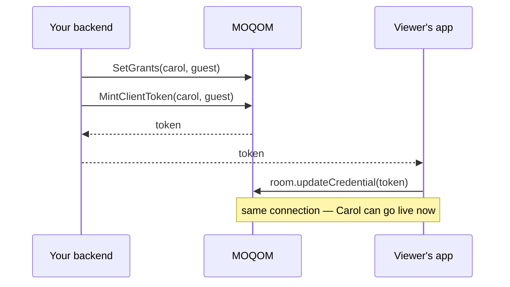
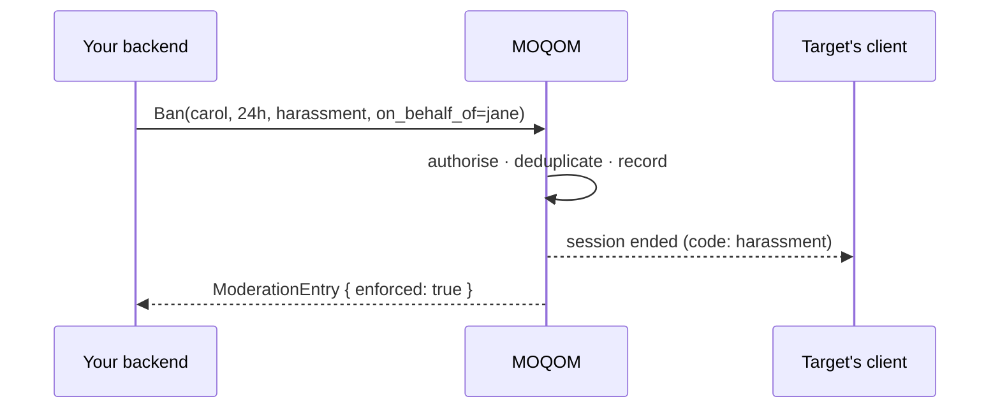

MOQOM's moderation is built on two promises:

1. **An action lands now.** A kick takes effect on the live session, not when the target's token
   next expires.
2. **An action is attributable.** Every call produces a `ModerationEntry` — the same record the
   moderation log serves and an appeal is heard against.

And one guarantee: **moderation is never blocked by billing.** A tenant out of credit can still
kick, ban and mute.

## Verbs

| Verb | Effect | Lasting record? |
| --- | --- | --- |
| **Kick** | Removes a participant now. They may rejoin. | Log entry only |
| **Ban** | Ends current sessions and refuses future ones — by account, device or address, for a room or the whole tenant, for a duration or permanently. | Yes |
| **Unban** | Lifts a ban early. | Yes |
| **ForceMute** | Stops someone's audio, video or screen share without their client's cooperation. | Until lifted or expired |
| **Unmute** | Lifts a force-mute (choose which scope). | — |
| **SetGrants** | Replaces a participant's publish scopes and capabilities. **Demotions apply immediately**; a promotion applies when the app presents a token for the new role — on the same connection. See [Promoting and demoting](#promoting-and-demoting). | Yes |
| **Spotlight** | Puts one participant on everyone's main tile, or clears it. | — |
| **CloseRoom** | Ends the room for everyone with a reason code. Idempotent. | Yes |
| **ListModerationLog** | Reads the audit trail. Requires `read_moderation_log`. | — |

### Targets

- `User("carol")` — every device Carol is signed in on. Almost always what a kick or ban means.
- `Device("carol", device)` — one device (a compromised laptop, one misbehaving phone).

### Ban subjects

| Subject | Beaten by | Collateral |
| --- | --- | --- |
| Account (`username`) | A new account | None |
| Device | A factory reset | None — survives a new account on the same hardware |
| Address (`ip_prefix`, CIDR) | Changing network | High — households, campuses, mobile NAT pools |

Prefer account and device bans; use address bans last.

A ban issued while the target is briefly offline still applies when they reconnect.

### Mute scopes

| Scope | Who stops receiving it |
| --- | --- |
| `everyone` | Nobody receives it, including other hosts. Enforced server-side; survives reconnection. |
| `audience` | The audience; hosts and cohosts still hear it. Ideal for "cohosts, sort this out off-air". |

A participant can be under both at once — say which one to lift.

## Promoting and demoting

There is no handoff. A viewer becomes a guest or a host on the connection they are already
watching on: the token's grants change, and nothing reconnects. The room keeps playing, the
roster does not flicker, and nobody sees them leave and come back.

**Promotion.** Call `SetGrants`, mint a token for the new role, and hand it to the app, which
calls `updateCredential` on the room it is in. The new powers are usable at once; going live is
still the participant's choice, so the app starts the camera when they tap the button.

**Demotion.** Call `SetGrants`. It takes effect immediately, without waiting for the app: whatever
the new grants no longer cover stops, and viewers see that participant leave the stage. The
participant stays in the room, still watching. Their app receives `publishingRevoked` and the SDK
turns the camera and microphone off.

A few things hold either way:

- **The same person, in the same room.** A token for somebody else, or for a different room, is
  ignored. Moving rooms is a join.
- **A demotion sticks.** A token the app kept from before the demotion cannot undo it, and nor can
  reconnecting. Tokens you mint after `SetGrants` are limited to what it set, so the next routine
  renewal agrees with the moderator.
- **Mutes survive.** A participant muted in the queue is still muted on stage.
- **Use a device key.** Changing a live session's grants needs the token to be bound to the app's
  device key (`DeviceKey.installed`). Without one, promote by having the app rejoin.

## Moderation codes

Every kick, ban and room closure carries a code that is sent to the affected client, so it can
say something true before the stream goes dark:

| Code | Use |
| --- | --- |
| `adult_content` | Sexual content |
| `violence` | Violent content |
| `harassment` | Harassment, hate |
| `self_harm` | Self-harm |
| `copyright` | Rights violation |
| `age_verification_required` | Room requires age verification the user lacks |
| `tenant_policy` | Your own policy |
| `operator_action` | A human decided and no category fits |

## Who may do what

Capabilities are a set. An actor may act on a target only when the actor's capability set is a
**strict superset** of the target's — so two moderators with identical powers cannot act on each
other, and nobody can act on an owner. `appoint_moderators` is only ever delegated by an owner.

Your backend key is an owner of its tenant. When it acts **on behalf of** a human moderator, pass
that person in `Actor.OnBehalfOf` so the log shows who decided.

## Did it work? — `enforced`

`ModerationEntry.enforced` is the honest answer:

- `true` — live sessions have been acted on.
- `false` — the record is written and future joins are refused, but a live session could not be
  confirmed yet. MOQOM keeps retrying; surface the state to your moderator rather than claiming
  success.

## Idempotency

Every mutating call takes an `idempotency_key`. A repeat with the same key returns the original
entry unchanged — so a queue that redelivers "ban for 24 hours" does not extend the ban. The SDKs
generate one per call; set your own when retries can come from another process.

## Watching moderation happen

Every action, whoever took it — your backend, another console, a client moderator, a safety
classifier — is emitted on the room's event stream as `ROOM_EVENT_KIND_MODERATION_APPLIED`
carrying the full `ModerationEntry`. `decided_by_model` is reserved for decisions MOQOM's own
systems make; when your model decides, name it and its version in the actor's reason. See
[Events](/guides/events-and-billing/), and [AI agents](/guides/ai-agents/) for classifiers and AI
hosts.

## From the client

Participants holding capabilities can moderate from MoqomKit with
`room.moderate(_:as:)` — see [iOS & macOS](/guides/ios-macos/#moderating-from-the-client). The
targeted client receives the action as an event (`captureRestricted`, `grantsChanged`) or a
terminal reason (`.moderated(code:)`).
