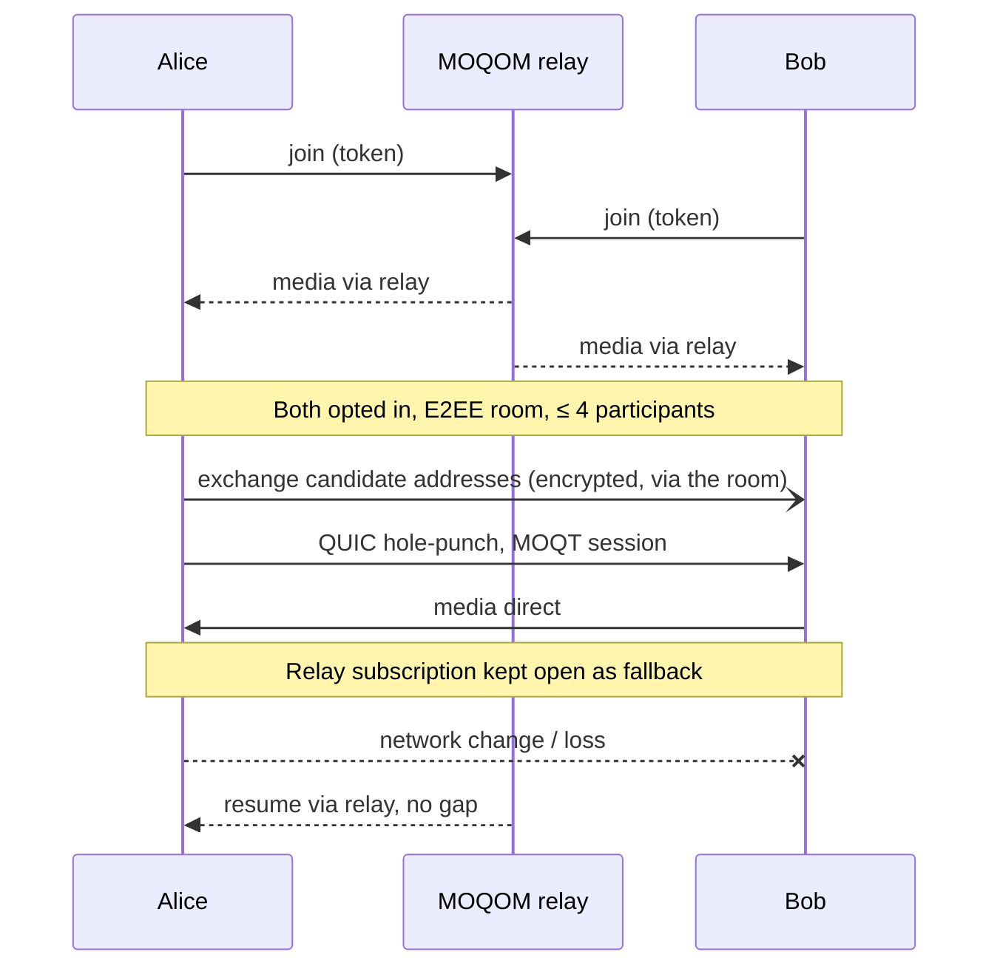

**1:1 calls are point to point.** Media flows straight from one phone to the other and never
reaches a MOQOM server. Private rooms of up to about four people can go direct too, when everyone
agrees. Whenever a direct path is unavailable, the call carries on through a relay without a gap,
still end-to-end encrypted. Broadcasts and audiences always go through relays.

## Why 1:1 calls are the most private thing MOQOM does

A 1:1 call is more private than a broadcast, and that is by design: fewer people hold the key,
and fewer machines ever touch the media. All of it works on iOS and macOS.

| | 1:1 call | Broadcast |
| --- | --- | --- |
| Who can decrypt | Exactly two devices, members of a two-device [MLS](/guides/e2ee/) group | Every member who may publish, every agent you run, and every viewer the group seals its keys to. Never MOQOM's servers |
| A new key when membership changes | Yes. A device that leaves can't read what comes next, and one that joins can't read what came before | Yes. Viewers get each new key sealed to them, and the key rotates every five minutes so a viewer who leaves stops reading |
| Check you're talking to the right device | Compare the epoch authenticator on both screens; if it matches, nobody else is in the group | Not practical across thousands of viewers |
| Server-side recording or classifiers | Impossible: the room is end-to-end encrypted, so a recorder would see ciphertext | Only as agents you run, inside the encrypted group and visible to every member |
| Stolen token | Useless: it only works with the device key it was issued to, which stays in the Secure Enclave | Same protection, but more tokens exist to steal |
| What the relay sees | Nothing at all on a direct path; ciphertext, sizes and timing on relay fallback | Ciphertext, sizes and timing |

Point to point is the last step: media goes from one phone to the other and never reaches a MOQOM
server, so there is nothing on our side to subpoena, breach or log. The cost is that the two
devices learn each other's IP address, which is why direct paths are only for people who are
calling each other and never for an audience. Your app can keep any call on the relay instead
(`directPolicy: .relayOnly`), and a room's policy can too.

```swift
let session = MoqomSession(
    transport: transport,
    credentials: credentials,
    tenant: tenant,
    directPolicy: .relayOnly // the default is .automatic
)
```

On the server, set `direct_paths: DIRECT_PATHS_RELAY_ONLY` on a room to keep everyone in it on
the relay, or `max_direct_participants` to lower the limit from four. Each token response states the
room's policy (`direct` in the [token response](/reference/device-tokens/#the-token-response)),
and relays issue no direct tickets in a relay-only room. If your backend mints tokens through the admin API, pass `MintClientTokenResponse.direct`
on to the device with the token; without it, the device assumes direct paths are allowed for up
to four people.

## What it buys, and what it costs

| | Relay | Direct |
| --- | --- | --- |
| Latency | Detour via the relay | Shortest path; largest gain on the same LAN or in the same city |
| Who carries media | Relay | The participants' devices only |
| What the relay sees | Ciphertext in E2EE rooms | Nothing — not even sizes and timing |
| **Peers learn each other's IP address** | No | **Yes** |
| Server-side recording and moderation | Only as agents you run, inside the encrypted group | Impossible |
| Fan-out | Thousands of viewers | Each extra peer costs the publisher a full upload |
| Works behind every NAT | Yes | Behind most home and office NATs with hole-punching; symmetric NATs stay on the relay |

The IP-address row decides where direct mode is allowed. Handing a viewer a creator's home IP
address is a stalking and doxxing risk, so **a direct path is never offered to an audience.**

## Where it's used

- **1:1 calls**: point to point by default. Your app tells both people before the call that the
  other will see their IP address; MoqomKit doesn't show that notice for you.
- **Private rooms of three or four**: when **every participant agrees**, with the IP exposure
  stated in your UI.

Never for public broadcast, never for viewers, never backstage (cohosts feeding a broadcast are on
the relay with it), and never when a recorder or safety watchdog is required in the room.

## How it works



1. **Join as usual through the relay.** Tokens, keys and room state work exactly as today, and
   media starts flowing through the relay immediately. Direct is an upgrade, never a
   precondition.
2. **Exchange candidates over the room**, encrypted so the relay carries them but cannot read
   them. Each device's candidates are its local addresses plus the public IPv4 and IPv6
   addresses the relay's [STUN](https://www.rfc-editor.org/rfc/rfc8489) responder (UDP 3478) reports for it; the token names that server,
   so apps configure nothing.
3. **Hole-punch with [QUIC](https://www.rfc-editor.org/rfc/rfc9000) NAT traversal** and speak MOQT directly between the devices. Media
   encryption is identical on both paths.
4. **Verify each other** with relay-issued direct tickets and device proofs, checked as strictly
   as a relay checks a token. See [the handshake](#the-handshake-step-by-step) below.
5. **Fall back without a gap** on loss or a network change. The relay subscription stays open
   while the direct path is in use, so each object is delivered once from whichever path brings
   it first.
6. **Billed by the minute, not by the byte.** The first 1,000 direct participant-minutes each
   calendar month (UTC) are free for each account; after that, direct time is $0.50 per 1,000
   participant-minutes, the same on MOQOM Cloud and self-hosted relays. Bytes sent device to
   device are never charged. Each device also keeps a standby connection to the relay
   so it can fall back, billed at cost while the call is direct: on MOQOM Cloud about $0.004 per participant-hour
   of connected time, plus anything the relay still carries, never the per-minute rate; on self-hosted relays, the usual per-GiB fee on what it carries.

## The handshake, step by step

A direct path skips the relay for media, so it must not skip the relay's checks. Each phone runs
the same admission code a relay does, ported line for line from the relay's Rust to Swift, and
both sides refuse before any media moves.

1. **Each device has a key it can't export.** When the app first registers a device, MoqomKit
   creates an [ML-DSA-87](https://csrc.nist.gov/pubs/fips/204/final) key in the Secure Enclave. Every MOQOM token names that key by its thumbprint
   (`cnf.jkt`), so a token is only good with the device it was minted for.
2. **A fresh certificate per call.** For each direct attempt, each phone makes a throwaway TLS
   certificate that lives only in memory, and puts its fingerprint in its **sealed offer**: the
   candidate addresses and the certificate's SHA-256, sealed with AES-256-GCM under a key derived
   from the room's [MLS](https://www.rfc-editor.org/rfc/rfc9420) group (and bound to the room's identifier), and published on the sender's
   own `.direct` track. The relay carries offers but can't read or forge them.
3. **Hole-punching.** Both phones send probes to each other's candidate addresses at once. The
   phone whose certificate fingerprint sorts lower dials, from the fixed port the other side has
   been probing, so both NATs see traffic they expect.
4. **Pinned mutual TLS.** Each side checks that the certificate the other presents is exactly the
   one in its sealed offer. A connection with any other certificate never completes, so a
   machine in the middle can't stand in for either phone.
5. **Direct ticket and proof of possession, both ways.** Peers never show each other their MOQOM
   tokens; tokens are [sealed](/security/libraries/token/#sealed-tokens), so a peer couldn't read
   one anyway. Instead, the relay issues each participant a **direct ticket** about once a minute,
   on the `.direct/{peer}` track: a relay-signed ML-DSA-87 [JWS](https://www.rfc-editor.org/rfc/rfc7515) of type
   `moqom-direct-ticket`. Over the new [QUIC](https://www.rfc-editor.org/rfc/rfc9000) connection each phone presents its current ticket
   plus a proof: an ML-DSA-87 signature from its Secure Enclave key, bound to the ticket by hash
   and to the **other phone's** certificate. The accepting side checks first:
   - the ticket is signed by MOQOM's relay, checked against keys the phone got from its own relay,
     never from the other phone, and is within its validity window;
   - the proof is signed by the key the ticket names (`jkt`), was made for this ticket and for
     this endpoint's certificate, and has never been presented before (each proof is accepted
     once);
   - the ticket is for the same tenant and room, grants publishing (a viewer is refused), and
     names the participant whose offer was accepted.

   It then answers with its own ticket and proof, and the dialler runs the same checks on it.

   | Ticket claim | Meaning |
   | --- | --- |
   | `ten` | Tenant |
   | `room` | Room |
   | `sub` | The participant's username |
   | `dev` | The participant's device |
   | `peer` | The other participant, the one this ticket lets the holder connect to |
   | `jkt` | The thumbprint of the holder's device key |
   | `pub` | What the holder may publish |
   | `iat`, `exp` | Issued and expires; a ticket lives about a minute |
6. **One final signal.** If the dialler accepts, it sends one empty stream as final admission.
   A refusal from either side closes the connection with code `0x03` and a reason in the relay's
   own wording, and neither side keeps a session the other refused.
7. **Media, still end to end.** MOQT runs directly between the phones, and media stays encrypted
   with the room's MLS keys exactly as it is through a relay.
8. **Fallback.** The relay subscription stays open but paused (draft-19 `FORWARD=0`). It resumes
   on any failure, or after 500 ms with nothing arriving directly.
9. **Tickets keep coming.** While on a direct path, each device receives a fresh ticket from its
   relay about once a minute and shows it to the other device. Direct minutes are counted from
   these tickets. A device ends the direct path and returns to the relay if the other side's
   ticket is missing, expired, for another room or not signed by MOQOM.

What this rules out: a stolen token or ticket (no device key), a replayed proof (each is used once
and bound to one certificate), a viewer, someone from another room, someone impersonating the person whose
offer was accepted, and a machine in the middle (pinned certificates on both sides).

## The QUIC stack on Apple platforms

Direct paths run on the same QUIC and TLS stack as every other MoqomKit connection: the MOQOM
engine's Rust library, `moqom-direct-ffi` (`quinn` and rustls with AWS-LC), reached through a
small C interface and shipped as an XCFramework inside the SDK. It keeps probing from the same
socket QUIC uses, so hole-punching continues while the path comes up, and direct paths carry QUIC
datagrams. Its key exchange is ML-KEM-1024 only, as on relay connections.

## Caveats

- **Carrier-grade NAT** on cellular networks is where hole-punching fails most, so
  phone-to-phone calls on cellular often stay on the relay.
- **Symmetric NATs** give each destination a new port, which defeats hole-punching over IPv4.
  When both devices have IPv6, which usually has no NAT, the call can still go direct over it.
  Otherwise it stays on the relay; MOQOM runs no TURN server, because the relay already is the
  fallback.
- What point to point is for is privacy: no MOQOM server carries the media at all, so any
  speed-up is a bonus where the network allows it.

## Zero-trust management plane

Separately from media, MOQOM's management surfaces run as *dark* services on an
[OpenZiti](https://openziti.io) overlay. A dark service has no listening port to find, and
reaching it takes an enrolled identity that the overlay's policy allows, checked on every
connection. These surfaces are the link from a relay to the control plane, each relay's admin
port, and the admin gRPC API. MOQOM's own relays reach the control plane only through the
overlay, and the link inside it is mutual TLS as well.

What this means for you:

- **BYOC relays** connect to MOQOM outbound only, with an overlay identity that's issued for your
  tenant and acts as the relay's licence. Revoking it cuts the link. Setup is in
  [Self-hosting relays](/guides/self-hosting/#3-connect-the-relay-to-the-control-plane).
- **Enterprise backends** can reach the admin API without it being on the public internet. A
  backend that embeds the OpenZiti Go SDK passes its dialler to the Go SDK:

  ```go
  overlay, _ := ziti.NewContext(identityConfig)
  client, err := moqom.Dial("moqom-api",
      moqom.WithDialer(func(_ context.Context, service string) (net.Conn, error) {
          return overlay.Dial(service)
      }),
      moqom.WithoutTransportSecurity(), // the overlay circuit is encrypted end to end
      moqom.WithTenant("acme"), moqom.WithCredential(key))
  ```

  Your API key is still required on top of the overlay identity. Contact us to take part.

Media stays on [QUIC](https://www.rfc-editor.org/rfc/rfc9000) directly, and viewers never need an overlay identity.
