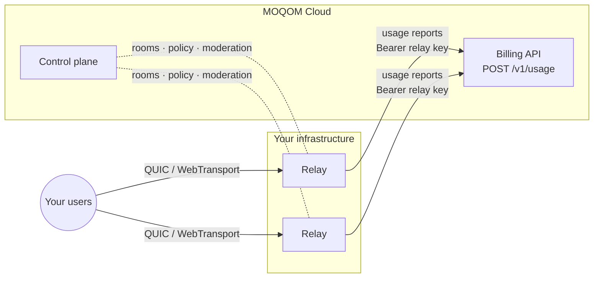

With a **BYOC** (bring your own cloud) licence you run MOQOM relays on your own machines while
MOQOM's control plane keeps handling rooms, moderation, tokens and billing. You pay for your own
bandwidth and compute; MOQOM charges only a per-GiB **[platform fee](/billing/self-hosted/)**.



:::tip[Only your relays]
Self-hosted relays already serve only your tenant. To make them the **only** relays your tenant
can use, so none of its traffic ever reaches the shared fleet, put them in a relay pool. See
[Private relay networks](/guides/private-networks/#your-own-relays-byoc).
:::

## Licensing

The relay is proprietary and ships as signed binaries under a BYOC licence. The licence permits
self-hosting for your own applications and users, including commercially, and prohibits offering
MOQOM to third parties as a hosted service. Its source isn't distributed. You don't need it to
verify what protects your media: media is end-to-end encrypted before it reaches a relay, and the
cryptography is open source in the [security libraries](/security/libraries/). Contact us through
[moqom.cloud](https://moqom.cloud) for a BYOC licence and relay distribution.

## 1. Issue a relay key

Relay keys can **only** report usage. They cannot call the admin API, mint tokens, or read
billing, so a leaked relay key cannot be used to take over rooms.

```sh
curl -sS https://api.moqom.cloud/v1/keys \
  -H "Authorization: Bearer $MOQOM_API_KEY" \
  -H 'Content-Type: application/json' \
  -d '{"name":"relay-us-east-1","kind":"relay"}'
```

```json
{
  "key": {
    "id": "5b7e0d2a9c3f1e48",
    "name": "relay-us-east-1",
    "kind": "relay",
    "created_at": "2026-10-06T09:12:44Z"
  },
  "api_key": "mqk_5b7e0d2a9c3f1e48_Jt3k…"
}
```

Issue one key per relay (or per region) so you can revoke one without touching the others.

## 2. Configure the relay to report usage

The MOQOM relay meters every session itself and reports to `POST /v1/usage`. Give it the relay
key in a file and it does the rest:

| Variable | Required | Meaning |
| --- | --- | --- |
| `MOQOM_RELAY_USAGE_KEY_FILE` | yes | Path to a file holding the `mqk_…` relay key. Reread on every report, so you can rotate the key in place without a restart. |
| `MOQOM_RELAY_ID` | yes, in practice | This relay's name. It is part of every record id, so **each relay reporting to one account needs its own**. Defaults to the host name. |
| `MOQOM_RELAY_USAGE_URL` | no | Defaults to `https://api.moqom.cloud/v1/usage`. |
| `MOQOM_RELAY_USAGE_INTERVAL` | no | Seconds per usage record. Default `60`. |
| `MOQOM_RELAY_USAGE_QUEUE` | no | Records held while the billing API is unreachable. Default `100000`. |
| `MOQOM_RELAY_USAGE_CA` | no | Extra certificate authorities to trust for the URL, as a PEM file. |

```sh
MOQOM_RELAY_ID=relay-us-east-1 \
MOQOM_RELAY_USAGE_KEY_FILE=/run/secrets/moqom-relay-key \
moqom-relay
```

With this set, the relay:

- sends one record per participant per interval, plus a final partial record when a session
  ends, and a last report when it is stopped gracefully;
- retries failed reports with the same ids, so an outage of the billing API costs nothing
  but a delay;
- stops admitting **new** sessions while billing says the account may not admit, and admits
  them again when it says it may — sessions already open are left alone. Until it first hears
  from billing, and while billing is unreachable, it keeps its last answer, which at startup is
  to admit;
- exposes `moqom_relay_usage_*` metrics on its admin port: records queued, sent, dropped and
  duplicate, report latency, the time of the last successful report, and whether it is admitting.

Neither `MOQOM_RELAY_USAGE_KEY_FILE` nor `MOQOM_RELAY_USAGE_URL` set means the relay meters
nothing.

### What each record says

| Field | How the relay decides it |
| --- | --- |
| `role` | `host` for a participant whose token lets them publish media or owns the room; `audience` for anyone else in a room; `broadcast_audience` for a view-only session with no room. A participant whose role changes during an interval is billed at the highest role they held in it. |
| `tier` | The largest total of video pixels the participant was receiving at once during the interval, from the publishers' catalogs: `audio` when no video, then `hd`, `full_hd`, `2k`, `2k_plus` at the [tier boundaries](/billing/tiers/). A track whose catalog gives no size is sized from its name (`video/1080p` is 1920×1080), and failing that counts as HD. |
| `seconds`, `egress_bytes`, `ingress_bytes` | Connected time in the interval, bytes sent to the participant and bytes received from them. |
| `room`, `participant` | The room and the user and device from the participant's verified token. |

A recording is billed like any other viewer.

In a tier of relays, each viewer is billed once, at the relay they are connected to. The link
from one relay to another is not billed when it carries a relay-link credential issued by MOQOM;
a link that signs in with an ordinary viewer token is billed as a viewer.

### Reporting from your own software

If you run something other than the MOQOM relay, report in the same shape yourself. Every record
is charged to the key's tenant, whatever the record says.

```sh
curl -sS https://api.moqom.cloud/v1/usage \
  -H "Authorization: Bearer $MOQOM_RELAY_KEY" \
  -H 'Content-Type: application/json' \
  -d '{
    "records": [{
      "id": "relay-us-east-1:2026-10-06T09:15:00Z:alice/9f2c41e0",
      "room": "live/42",
      "participant": "alice/9f2c41e0",
      "role": "host",
      "tier": "hd",
      "seconds": 60,
      "egress_bytes": 52428800,
      "ingress_bytes": 9437184
    }]
  }'
```

```json
{
  "charged": 1,
  "duplicates": 0,
  "unbilled": 0,
  "total": { "micros": 488, "display": "$0.000488" },
  "admitted": true
}
```

The full schema is in the [Usage reporting API](/reference/usage-api/). The important rules:

- **`id` makes a report idempotent.** Retry freely; a record whose `id` was already charged is
  counted in `duplicates` and charged nothing.
- **At most 5,000 records per request.**
- **`admitted`** tells your relay whether the tenant may still admit new sessions. When it turns
  `false` (balance spent, tenant suspended), stop admitting new sessions until it is `true`
  again. Existing sessions and moderation are unaffected.

## 3. Connect the relay to the control plane

A relay picks up verification keys, moderation directives and room state over a link to MOQOM's
control plane. A BYOC relay makes that link **outbound only**, over an
[OpenZiti](https://openziti.io) overlay that MOQOM runs, so you open no inbound ports and the
link needs no credential on disk beyond the overlay identity. That identity is your relay's
licence: it's issued for one tenant, and revoking it cuts the link.

Ask us for an enrolment token for your tenant; each one is single-use and expires after 24
hours.

1. Install the [OpenZiti CLI](https://openziti.io/docs/downloads) (or use the
   `openziti/ziti-cli` container image) and enrol the token. Keep the output file private:

   ```sh
   ziti edge enroll --jwt relay.jwt --out /etc/moqom/relay-identity.json
   chmod 600 /etc/moqom/relay-identity.json
   ```

2. Run the tunneler beside the relay. It opens a listener on `127.0.0.1:18444` that carries
   the link over the overlay:

   ```sh
   ziti tunnel proxy --identity /etc/moqom/relay-identity.json
   ```

3. Point the relay at it and pin the relay to your tenant. Don't set `MOQOM_CONTROL_CREDENTIAL`;
   the overlay identity is the credential:

   ```sh
   MOQOM_CONTROL_ENDPOINT=http://127.0.0.1:18444 \
   MOQOM_RELAY_TENANT=your-tenant \
   MOQOM_RELAY_ID=relay-us-east-1 \
   MOQOM_RELAY_USAGE_KEY_FILE=/run/secrets/moqom-relay-key \
   moqom-relay
   ```

   A working link logs `attached to the control plane`, then
   `took the control plane's verification keys`.

The plain `http://` refers only to the hop to the tunneler on loopback. From there the overlay
carries the link encrypted end to end to the control plane.

The relay needs outbound TCP to the controller and edge router addresses that are in the
enrolment token, and that's all. The overlay's policy lets the identity reach one control-plane
service, where it's treated as a relay and so refused the admin API. The control plane gives a
BYOC relay only its own tenant's sessions, moderation and live-map data, whatever the relay asks
for.

**Revocation.** When an enrolment is revoked, the identity is deleted and the relay's live link
is closed, within 30 seconds at most, and the relay can't reconnect with that identity. Once
the link is down, the relay keeps its open sessions, but after the grace period the control
plane set when it attached, it stops admitting new ones. This is the same thing that happens to
any relay that loses its link. To move a relay to new hardware, ask for a new token and enrol it
there.

## 4. What you pay

Self-hosted usage is charged the platform fee on egress only — no bandwidth or compute cost from
MOQOM, because you paid for those yourself — and never costs more than the
[hosted rate](/billing/tiers/) for the same minutes. See [Self-hosted fee](/billing/self-hosted/).

## Operations

- **Rotate** a relay key with `POST /v1/keys/{id}/rotate`: the replacement works at once and the
  old key keeps working for the overlap (24 hours by default), so relays never stop reporting.
  Write the new key over the file `MOQOM_RELAY_USAGE_KEY_FILE` names; the next report uses it.
- **A refused key** is logged as an error on every attempt and the records are kept and
  retried, so fixing the key resumes reporting where it stopped. A record the billing API
  rejects as invalid is logged and dropped rather than retried.
- **Stopping**: on `SIGTERM` the relay drains, closes every session's last interval and spends
  up to 10 seconds delivering what it holds. Records still undelivered after that, or pushed out
  of a full queue during a long outage, are counted in `moqom_relay_usage_records_dropped_total` and
  logged.
- **Observability**: the relay exposes Prometheus metrics, health/readiness and JSON session
  snapshots on a separate admin port, **off by default and unauthenticated** — bind it to a
  private interface only.
- **Ports**: [QUIC](https://www.rfc-editor.org/rfc/rfc9000) and [WebTransport](https://datatracker.ietf.org/doc/draft-ietf-webtrans-http3/) share **one UDP port**. The relay also answers [STUN](https://www.rfc-editor.org/rfc/rfc8489) on
  **UDP 3478**, so devices behind NAT can find their public address and go direct in 1:1 calls
  and small rooms. Set `MOQOM_RELAY_STUN_ADDR` to change the address or `off` to disable it;
  `MOQOM_RELAY_STUN_RATE` and `MOQOM_RELAY_STUN_BURST` (default 20 per second, burst 40) limit
  each source address. Without it, direct paths only open between devices on the same network.
