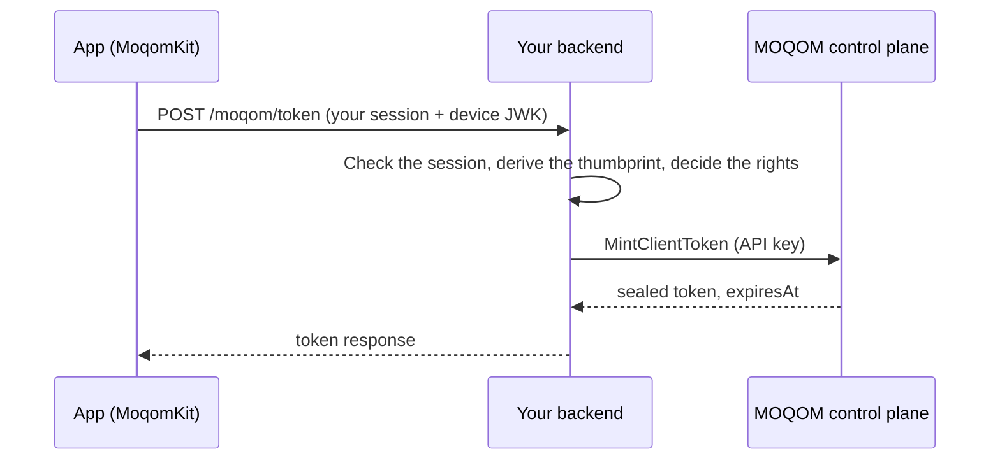

A device joins a room with a token that names its own key. Something that knows who the person
is has to ask for that token, and that something never runs in the app: **no long-lived secret
ships in any app.** There is no device credential and no route a phone can call with a key of its
own to mint for itself.

There are three ways to get a token onto a device. All three bind it to the device's
[ML-DSA-87](https://csrc.nist.gov/pubs/fips/204/final) key, last at most fifteen minutes, and
return the same [response](#the-token-response), so the app code is the same whichever you use.

| | [Your backend mints](#1-your-backend-mints) | [Reference token server](#2-the-reference-token-server) | [Apple sign-in hosted by MOQOM](#3-apple-sign-in-hosted-by-moqom) |
| --- | --- | --- | --- |
| Who runs it | You | You, from open source | MOQOM's control plane |
| Who signs the person in | Your existing sign-in | Sign in with Apple | Sign in with Apple |
| What proves it's your app | Your own session | Apple's audience check on your bundle IDs | App Attest, plus Apple's audience check |
| Rooms | Any room your rules allow | A fixed list | Existing rooms you list |
| Grants | Anything your API key may mint | Publish only | Publish only |
| Moderation or ownership | If you mint it | Never | Never |
| Creates rooms | If your backend does | Never | Never |
| Use it when | You have a backend and users | You want your own server but no user database | You have no backend at all |

A real product normally uses the first. The other two exist so an app with no backend of its own
can still give each person their own name, their own device binding and nothing more.

## The token is opaque

Every MOQOM token is signed with ML-DSA-87 and then sealed with AES-256-GCM under a key that only
MOQOM's control plane and relays hold. To the app, your backend and your logs it is opaque bytes:
there is nothing in it to decode. Pass it to the SDK as it is.

Everything the app needs to know about the token comes back beside it, in the response. Schedule
renewal from `expiresAt`, show the `username` it gives you, and read what the device may publish
from `publish`. See [Sealed tokens](/security/libraries/token/#sealed-tokens) for the format.

## The token response

Whichever way the token is minted, the device receives this JSON, and `TokenService` reads it.

```json
{
  "token": "AQ3k…",
  "expiresAt": "2026-10-09T09:35:00Z",
  "tenant": "t_3f9a0c1d2e4b5a69",
  "room": "demo",
  "username": "alice",
  "device": "Xq3v…full-thumbprint…",
  "keyId": "k-2026-10",
  "publish": ["audio", "video"],
  "direct": { "allowed": true, "maxParticipants": 4, "stun": { "host": "relay.example.moqom.cloud", "port": 3478 } }
}
```

| Field | Meaning |
| --- | --- |
| `token` | The sealed token, about 6.6 KB. Pass it to the SDK; never parse it. |
| `expiresAt` | When it stops being accepted, in [RFC 3339](https://www.rfc-editor.org/rfc/rfc3339). The SDK renews before this. |
| `tenant` | The tenant the token is for |
| `room` | The room it admits the holder to |
| `username` | The name actually minted, after normalisation. Display this one. |
| `device` | The full thumbprint of the device key the token is bound to. Compare it with the device's own. |
| `keyId` | The signing key ID |
| `publish` | What the holder may publish: any of `audio`, `video`, `screen_share` and `data`. Empty for a viewer. |
| `direct` | Optional. The room's [point-to-point](/guides/peer-to-peer/) policy: whether direct paths are `allowed`, `maxParticipants`, and the relay's STUN server. Without it, the device assumes direct paths are allowed for up to four people. |
| `relays` | Optional. The relay addresses a token for a [private relay pool](/guides/private-networks/) must dial, such as `["relay-1.production.example.moqom.cloud:443"]`. Absent for the shared fleet. Any other relay refuses the token with `wrong_pool`. |

Serve it with `Cache-Control: no-store`.

### In Swift

`TokenService` asks for a token and returns an `IssuedToken`:

```swift
let service = TokenService(
    url: URL(string: "https://api.example.com/moqom/token")!,
    authorization: try await Account.current.accessToken(), // your own session
    certificateHashes: []                                    // optional pins, SHA-256 of the leaf
)
let issued = try await service.token(username: "alice", room: "demo", device: deviceKey)
```

It sends `POST <url>` with `Authorization: Bearer <authorization>` and this body:

```json
{
  "key": { "kty": "AKP", "alg": "ML-DSA-87", "pub": "…" },
  "device": "Xq3vT0aL9mRkQ2pB",
  "room": "demo",
  "username": "alice"
}
```

| Field | Meaning |
| --- | --- |
| `key` | The device's **public** key as a [JWK](https://www.rfc-editor.org/rfc/rfc7517), from `DeviceKey.jwk` |
| `device` | The device's 16-character ID, the start of the key's thumbprint. A server should refuse a request whose `key` doesn't start with it. |
| `room` | The room the app wants to join |
| `username` | The name the app asks for. Your server decides the real one. |

`IssuedToken` carries the response: `token` (opaque `Data`), `expiresAt`, `tenant`, `username`,
`room`, `device` (the full thumbprint), `publish` (a `PublishScope`, or nil), `mayPublish` and
`direct`. `TokenService` accepts only `https` URLs. When the server answers `401`, the error is a
`TokenServiceError` whose `needsSignIn` is true: send the person back through sign-in.

```swift
do {
    issued = try await service.token(username: name, room: "demo", device: deviceKey)
} catch let error as TokenServiceError where error.needsSignIn {
    showSignIn()
}
```

## 1. Your backend mints

This is the normal way. The app signs the person in however it already does, then sends its
device public key to your backend. Your backend checks the session, decides which room and which
rights this person gets, and calls [`MintClientToken`](/reference/control-plane-grpc/#tokens)
with your API key. The API key stays on your server.



**On your server**, with [moqom-go](/guides/backend-go/#mint-a-token) and
[`moqom-proof`](/security/libraries/proof/) to derive the thumbprint:

```go
http.HandleFunc("POST /moqom/token", func(w http.ResponseWriter, r *http.Request) {
    user, err := auth.UserFromRequest(r) // your existing sign-in
    if err != nil {
        http.Error(w, "unauthorized", http.StatusUnauthorized)
        return
    }
    var req struct {
        Key    proof.JWK `json:"key"`
        Device string    `json:"device"`
        Room   string    `json:"room"`
    }
    if err := json.NewDecoder(r.Body).Decode(&req); err != nil {
        http.Error(w, "bad request", http.StatusBadRequest)
        return
    }
    thumbprint, err := req.Key.Thumbprint() // derived here, never taken from the device
    if err != nil || !strings.HasPrefix(thumbprint, req.Device) {
        http.Error(w, "bad key", http.StatusBadRequest)
        return
    }
    if !user.MayJoin(req.Room) { // your rules: who may join which room, with what rights
        http.Error(w, "forbidden", http.StatusForbidden)
        return
    }

    token, err := client.MintToken(r.Context(), moqom.TokenRequest{
        Username:         user.ID, // yours, not the name the app asked for
        DeviceThumbprint: thumbprint,
        Room:             req.Room,
        Publish:          moqom.PublishCamera,
        Lifetime:         10 * time.Minute,
    })
    if err != nil {
        http.Error(w, "unavailable", http.StatusServiceUnavailable)
        return
    }
    w.Header().Set("Cache-Control", "no-store")
    json.NewEncoder(w).Encode(map[string]any{
        "token":     token.Token,
        "expiresAt": token.ExpiresAt, // RFC 3339
        "tenant":    os.Getenv("MOQOM_TENANT"),
        "room":      req.Room,
        "username":  token.Identity.Username,
        "device":    thumbprint,
        "keyId":     token.KeyID,
        "publish":   []string{"audio", "video"},
    })
})
```

If your tenant runs on a [private relay pool](/guides/private-networks/), pass the mint
response's `relays` through to the app as well. The Rust SDK has the same call. **In the app**, point `TokenService` at this route with your own
session as `authorization`, and use the same call for the first token and for `renew`; the
[iOS & macOS guide](/guides/ios-macos/#tokens-and-renewal) has the whole flow.

## 2. The reference token server

`moqom-sample-tokens` is a small open-source token server that signs people in with **Sign in
with Apple** and mints for them. It lives in the MOQOM repository at `go/cmd/moqom-sample-tokens`,
runs as one Go binary, and deploys to Cloud Run as it is. Run it when you want tokens from a
server you control but have no user database of your own. Read it when you are writing your own
backend: it is a complete, short example of the first way.

### Signing in

The app asks Apple to sign the person in with the **device key's thumbprint as the nonce**, then
sends Apple's identity token and the device's public key:

```http
POST /v1/sign-in
Content-Type: application/json

{"identityToken": "<Apple identity token>", "key": {"kty":"AKP","alg":"ML-DSA-87","pub":"…"}, "room": "lobby"}
```

The server checks, before minting anything:

- Apple's RS256 signature, against Apple's published keys;
- the issuer is `https://appleid.apple.com`;
- the audience is one of your bundle IDs;
- the identity token hasn't expired;
- the nonce equals the thumbprint of `key`, so the sign-in was made for this device and no other.

It answers with the [token response](#the-token-response) plus two fields:

| Field | Meaning |
| --- | --- |
| `enrollment` | An opaque credential for this person on this device, sealed with AES-256-GCM. The app keeps it in the Keychain. |
| `enrollmentExpiresAt` | When the enrollment ends: 30 days after sign-in. After that the person signs in again. |

### Renewing

```http
POST /v1/token
Authorization: Bearer <enrollment>
Content-Type: application/json

{"key": {"kty":"AKP","alg":"ML-DSA-87","pub":"…"}, "room": "lobby"}
```

This mints a fresh token without asking Apple again. The `key` must be the one the enrollment was
made for, so an enrollment copied off the device mints nothing anywhere else.

### What it will mint

- **Usernames** are `apple-` followed by a hash of Apple's subject. The subject itself never
  reaches MOQOM.
- **Rooms** come from a fixed list (`MOQOM_TOKENS_ROOMS`). A phone can't create a room or ask for
  one that isn't listed.
- **Grants** are publish only: never moderation, never ownership.
- **Rate limit:** 30 tokens per person per 10 minutes.

### Configuration

| Variable | Meaning |
| --- | --- |
| `MOQOM_TOKENS_TARGET` | The admin API address it mints through |
| `MOQOM_TOKENS_CREDENTIAL` | The API key it mints with. A [`mint` key](/reference/billing-api/#key-kinds) is enough. |
| `MOQOM_TOKENS_TENANT` | Your tenant |
| `MOQOM_TOKENS_AUDIENCES` | Your app's bundle IDs, the audiences Apple's identity tokens must name |
| `MOQOM_TOKENS_ROOMS` | The rooms it will mint for |
| `MOQOM_TOKENS_ENROLLMENT_KEY` | 32 random bytes, base64url, that seal enrollments. Keep it in your secret manager. |
| `MOQOM_ADMIN_CA`, `MOQOM_ADMIN_CERT`, `MOQOM_ADMIN_KEY` | Mutual TLS to the admin API |

### In Swift

```swift
// Sign in with Apple, with this device's key in the nonce.
let request = ASAuthorizationAppleIDProvider().createRequest()
request.nonce = deviceKey.thumbprint
// … when Apple returns the credential:
let signIn = try await TokenService.signIn(
    url: URL(string: "https://tokens.example.com/v1/sign-in")!,
    identityToken: identityToken,     // from ASAuthorizationAppleIDCredential
    room: "lobby",
    device: deviceKey
)
// signIn.issued is the first IssuedToken. Keep the enrollment in the Keychain.
try keychain.save(signIn.enrollment, until: signIn.enrollmentExpiresAt)

// Every later token, including renewals:
let service = TokenService(
    url: URL(string: "https://tokens.example.com/v1/token")!,
    authorization: signIn.enrollment
)
```

The `MoqomRoom` sample app works this way: a Sign in with Apple button in Settings, and the
enrollment in the Keychain.

## 3. Apple sign-in hosted by MOQOM

For an app with no backend at all, MOQOM's control plane can sign people in and mint for them
itself. It checks three things, each answering a different question:

- **App Attest** proves the request comes from your genuine app, on a real Apple device.
- **Sign in with Apple** names the person.
- **The device key** binds the token to this device, as it does for every MOQOM token.

### Turn it on

Configure it per tenant with the admin API's `SetAppleSignIn`, using a `backend` key:

| Setting | Meaning |
| --- | --- |
| Apple team ID | The team your app is signed by. App Attest attestations from any other team are refused. |
| Bundle IDs | Your apps. Apple's identity tokens must name one of them as the audience. |
| Rooms | Which existing rooms it may mint for. It never creates a room. |
| Publish grants | What a signed-in person may publish there. It never grants moderation or ownership. |

### Signing in

The app asks Apple to sign the person in with the device key's thumbprint as the nonce, then
attests its App Attest key with the SHA-256 of Apple's identity token as the client data hash:

```swift
let attest = DCAppAttestService.shared
let attestKeyId = try await attest.generateKey()
let attestation = try await attest.attestKey(attestKeyId,
                                             clientDataHash: Data(SHA256.hash(data: identityToken)))
```

and sends both to the control plane's public host:

```http
POST /v1/apple/sign-in
Content-Type: application/json

{
  "tenant": "t_3f9a0c1d2e4b5a69",
  "identityToken": "<Apple identity token>",
  "attestation": "<App Attest attestation object, base64>",
  "attestKeyId": "<App Attest key ID>",
  "key": {"kty":"AKP","alg":"ML-DSA-87","pub":"…"},
  "room": "lobby"
}
```

The answer is the [token response](#the-token-response) plus `enrollment` and
`enrollmentExpiresAt`, as with the reference token server.

### Renewing

```http
POST /v1/apple/token
Authorization: Bearer <enrollment>
X-Moqom-Assertion: <App Attest assertion, base64>
Content-Type: application/json

{"key": {"kty":"AKP","alg":"ML-DSA-87","pub":"…"}, "room": "lobby"}
```

`X-Moqom-Assertion` is an App Attest assertion over the SHA-256 of the exact request body, made
with the key attested at sign-in:

```swift
let assertion = try await DCAppAttestService.shared.generateAssertion(
    attestKeyId, clientDataHash: Data(SHA256.hash(data: body)))
```

Each renewal therefore proves again that it comes from your app on the same device. App Attest's
counter must rise with every assertion, so a captured renewal cannot be replayed.

In Swift the same types carry the result: `IssuedToken` for each token, `TokenService.SignIn`
for the first sign-in and its enrollment, and `TokenService` pointed at
`https://<control plane host>/v1/apple/token` for renewals.

## Invitation links

An invitation carries addresses and certificate pins, never a secret:

```text
moqom://join?relay=relay.example.moqom.cloud:443&cert=<sha256>&tokens=https://tokens.example.com&mls=keys.example.moqom.cloud:443&mlscert=<sha256>&room=lobby
```

| Parameter | Meaning |
| --- | --- |
| `relay`, `cert` | The relay to connect to, and the SHA-256 of its certificate |
| `tokens` | The `https` URL of the token server the app should sign in with |
| `mls`, `mlscert` | The [MLS key service](/guides/e2ee/#managed-keys-swift), and the SHA-256 of its certificate |
| `room` | The room to join |

`RelayInvitation` reads these links. Older links with `token=` or `key=` parameters still open,
but those parameters are ignored: a token comes only from the token server, after sign-in.
