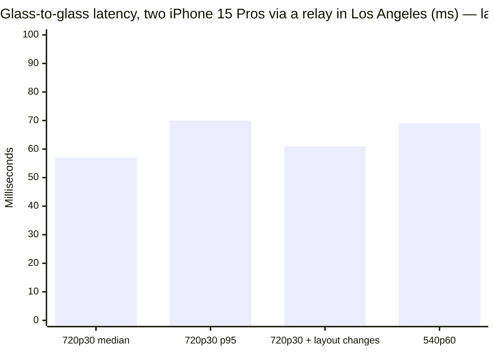
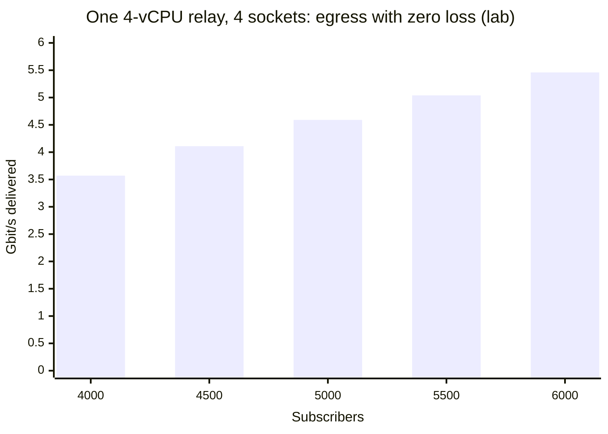

:::caution[Benchmark note]
\* Built to scale: a Rust media plane and a Go control plane, each scaling out horizontally. Measured in lab: 6,000 viewers on one 4-vCPU relay, every frame delivered. Full data at [moqom.cloud/benchmarks/load-tests.md](https://moqom.cloud/benchmarks/load-tests.md).
:::

## Headline

| Metric | Result | Conditions |
| --- | --- | --- |
| Glass-to-glass latency, median | **56–57 ms** | 720p30 at 1.25 Mbit/s HEVC, two iPhone 15 Pros, home network, relay in Los Angeles, both directions at once |
| Glass-to-glass latency, p95 | **70 ms** | Same run, every frame delivered |
| Fan-out, one relay, no loss | **6,000 subscribers at 5.46 Gbit/s** | 4 vCPU (GCP n2-standard-4), 4 sockets, 3.88 cores busy |
| Relay efficiency | **~1.3–1.4 Gbit/s egress per vCPU** | Consistent across synthetic and real-video runs |
| [SFrame](https://www.rfc-editor.org/rfc/rfc9605) cost | **54 µs** per 1080p keyframe | AES-256-GCM on device, against a 33 ms frame budget |
| Data message decode | **5.7 µs** per 50-entity game tick, zero-copy | 163 µs for the same tick as JSON; see [Data messages](#data-messages) |

## Data messages

Data tracks use MOQOM's flat record format: a FlatBuffers-style layout the client reads straight
out of the received buffer. Position arrays are a contiguous run of little-endian floats, so the
reader points at them instead of decoding them, allocates nothing, and can hand them to a GPU
buffer whole. There is no FlatBuffers runtime to ship.

| Operation | Result | Conditions |
| --- | --- | --- |
| Read every position in a 50-entity tick, zero-copy view | **5.7 µs** | No allocation |
| Same, decoded into a dictionary | **5.9 µs** | One dictionary and 50 strings per tick |
| Same, as JSON | **163 µs** | `JSONDecoder`, about 29× slower than the view |
| Size of that tick | **1,831 bytes** | 3,528 bytes as JSON (1.9×) |
| Seal / open a 60-byte message ([SFrame](https://www.rfc-editor.org/rfc/rfc9605), AES-256-GCM) | **3.2 µs / 3.2 µs** | 19 bytes of overhead |
| Seal / open a 2 KB message | **4.0 µs / 3.8 µs** | 19 bytes of overhead |

Measured in a release build on an Apple M1 Pro MacBook Pro, averaged over 200 runs after warm-up,
by `SpaceCostTests` and `EncryptionCostTests` in the Swift SDK. These are on-device costs; network
time through the relay is the same as for media.

## Latency by resolution

Glass to glass at each size the camera publishes, largest first. Co-host sizes (540p and 360p)
matter most: shared video calls use smaller boxes, so they publish at 360p–540p.

:::caution[Benchmark note]
\* Built to scale: a Rust media plane and a Go control plane, each scaling out horizontally. Measured in lab: 6,000 viewers on one 4-vCPU relay, every frame delivered. Full data at [moqom.cloud/benchmarks/load-tests.md](https://moqom.cloud/benchmarks/load-tests.md).
:::

| Resolution | Typical use | Median glass-to-glass | Status |
| --- | --- | --- | --- |
| **4K (2160p30)** | Solo host, broadcast | Not yet measured | 4K rung added to the Swift SDK camera ladder (opt-in); end-to-end run scheduled |
| 1080p30 | Host / spotlight | Not yet measured | Supported (top rung of default camera ladder) |
| 720p30, 1.25 Mbit/s HEVC | Two-person call | **56–57 ms** (p95 70 ms) | Measured: two iPhone 15 Pros, home Wi-Fi, relay in Los Angeles, both phones publishing and decoding at once, 90 s, every frame delivered |
| 540p60, 600 kbps | Co-hosting | **69 ms** | Measured on a live co-hosted call, same relay: each phone publishing its camera while receiving and decoding the other host’s video |
| 360p30 | Co-host tiles in shared calls | Not yet measured | Supported (600 kbps rung) |
| Shared video calls (360p–540p per tile) | Group calls, co-host grids | Not yet measured | Closest references: 540p60 at 69 ms; 720p30 with the layout changing every 8 s at 61 ms |

:::note[Shared video calls]
In a shared call, each person publishes at the size of their tile (360p–540p) rather than a full
frame, so each person's stream is smaller. The shared-call median is not yet measured.
Until it is, the closest measured references are the 540p60 run (69 ms median) and a 720p30 run
with the layout changing every 8 seconds (61 ms median), both in [Results](#results) below.
:::

How these numbers sit against other platforms' published figures:
[How MOQOM compares](/getting-started/compare/).

## Glass-to-glass latency

*Glass to glass* is the time from light hitting the sender's camera to the frame being on the
receiver's screen: capture, encode, packetising, the network both ways through the relay,
buffering, decode and display — everything a person on a call experiences.

### Rig

| | |
| --- | --- |
| Devices | Two iPhone 15 Pros, chosen as a hard case: a model with known heat issues, older than the two latest generations MOQOM targets. Newer phones are preferred for clients. |
| Relay | GCP Compute Engine, Los Angeles (`us-west2`) |
| Network | Ordinary home Wi-Fi in Venice Beach, California (about 108 Mbps down, 8 Mbps up), shared with TVs and other devices streaming movies during the runs; mean round trip to the relay 21.8 ms |
| Media | 720p HEVC from the camera, VideoToolbox hardware encode |
| Direction | Both phones publish and subscribe at once |
| Clocks | Both disciplined against NTP; error bar reported beside every reading |

### Results

:::caution[Benchmark note]
\* Built to scale: a Rust media plane and a Go control plane, each scaling out horizontally. Measured in lab: 6,000 viewers on one 4-vCPU relay, every frame delivered. Full data at [moqom.cloud/benchmarks/load-tests.md](https://moqom.cloud/benchmarks/load-tests.md).
:::

| Scenario | Median | p95 | Notes |
| --- | --- | --- | --- |
| 720p30 at 1.25 Mbit/s HEVC, both directions, 90 s | **56–57 ms** | **70 ms** | Every frame delivered |
| 720p30, layout changing every 8 s | 61 ms | — | |
| 540p60 at 600 kbps, co-hosting | 69 ms | — | Same relay; each phone publishing and decoding the other host at once |

Roughly 22 ms of the median is the network round trip to the relay. The rest is the device:
capture, hardware encode, decode and the display's refresh. On this rig, the time left to remove
is mostly on the phone, not in the relay.

## Relay fan-out

One publisher sends one track, and the relay copies each object to *N* subscribers. The
publisher uploads once however large the audience is: copying to every viewer is the relay's
job, on the server, so a phone's upload and battery don't grow with the audience.

Each subscriber count is its own test run, and the relay process is started fresh for each run
so connections and buffers left over from one size can't help or hurt the next. That is test
hygiene only: nothing restarts during a run, and a live room never restarts a relay to take on
more viewers. A size is **clean** only if every subscriber received every object and no packet
was lost on the way in; subscriber reports and the relay's own counters are read together.

### How long fan-out takes

The relay forwards as data arrives. It starts copying an object to its subscribers as soon as
the first bytes are in, rather than waiting for the whole frame or for a batch, and the copies
are spread across every core. At 6,000 subscribers that is 30 objects a second to each of them,
180,000 deliveries a second, with every object delivered and nothing shed.

End to end, relay included, a frame takes 56–57 ms from one phone's camera to another's screen
(see [Glass-to-glass latency](#glass-to-glass-latency)), and about 22 ms of that is the network
round trip. The relay's own share was not separated in that run, and per-object delivery time at
6,000 subscribers was not recorded in the runs below; it is listed under
[Not yet measured](#not-yet-measured).

### Data messages fan out the same way

App data rides the same fan-out as video. Chat, reactions, user events such as joins, hand
raises and polls, game state and telemetry are tracks your app publishes, and the relay delivers
each message to every subscriber of that track, end-to-end encrypted like media. A data message
is usually tens to a few thousand bytes, against 4,096-byte frames in the synthetic run below,
so it costs the relay less to fan out per message. Reading and sealing them on the device is
measured under [Data messages](#data-messages).

### Rig

| Role | Machine |
| --- | --- |
| Relay | GCP n2-standard-4 (4 vCPU), us-east1-b |
| Subscribers | 2 × n2-standard-8 load generators, split evenly |
| Publisher | n2-standard-2 |
| Network | One zone, gVNIC, MTU 1460, `rmem_max`/`wmem_max` 128 MiB |
| Relay binary | Identical across every run below |

### Synthetic traffic: 30 fps of 4,096-byte frames

:::caution[Benchmark note]
\* Built to scale: a Rust media plane and a Go control plane, each scaling out horizontally. Measured in lab: 6,000 viewers on one 4-vCPU relay, every frame delivered. Full data at [moqom.cloud/benchmarks/load-tests.md](https://moqom.cloud/benchmarks/load-tests.md).
:::

| Subscribers | Sockets | Clean | Relay cores | Gbit/s |
| ---: | ---: | --- | ---: | ---: |
| 3,500 | 1 | yes | 2.97 | 3.12 |
| 4,000 | 1 | yes | 3.44 | 3.55 |
| 4,000 | 4 | yes | 3.50 | 3.57 |
| 4,500 | 4 | yes | 3.76 | 4.11 |
| 5,000 | 4 | yes | 3.82 | 4.59 |
| 5,500 | 4 | yes | 3.82 | 5.04 |
| 6,000 | 4 | yes | 3.88 | 5.46 |

**Reading it.** With four `SO_REUSEPORT` sockets sharing the port, packet handling is spread
across the cores and the relay stays clean through 6,000, the largest size run. **6,000 is the
largest size tested, not the ceiling.** CPU is close to saturated at 3.88 of 4 cores and the machine's 10 Gbit/s egress cap was not reached, so the next limit is CPU
and the next step is a larger machine.

### Real video: H.264 clip at 24 fps

Real video is the number to prefer: a keyframe arrives as a burst many times the size of its
neighbours, and that burst is where fan-out costs.

:::caution[Benchmark note]
\* Built to scale: a Rust media plane and a Go control plane, each scaling out horizontally. Measured in lab: 6,000 viewers on one 4-vCPU relay, every frame delivered. Full data at [moqom.cloud/benchmarks/load-tests.md](https://moqom.cloud/benchmarks/load-tests.md).
:::

| Run | Subscribers | Sockets | Clean | Relay cores | Gbit/s |
| --- | ---: | ---: | --- | ---: | ---: |
| A | 1,000 | 1 | yes | 0.46 | 0.57 |
| A | 2,000 | 1 | yes | 0.85 | 1.12 |
| B | 3,000 | 4 | no | 0.99 | 1.34 |
| C | 2,000 | 1 | yes | 2.09 | 2.78 |
| D | 2,000 | 4 | yes | 2.00 | 2.66 |
| D | 2,500 | 4 | no | 2.55 | 3.34 |

The clip changed between runs B and C: per-subscriber bitrate went from about 0.56 to
1.39 Mbit/s. Compare rows within a run, and compare runs by **Gbit/s per core (1.2–1.4)** rather
than subscribers per core, which depends entirely on bitrate. "Not clean" rows are
subscriber-side loss; those sizes need profiling before they are quoted.

## Not yet measured

- **Per-object delivery time under fan-out.** How long each object takes from the publisher to
  every subscriber at 1,000 to 6,000 subscribers, including the relay's own share. The load
  generator measures it; the runs above did not record it.
- **Data-message fan-out.** Chat-sized and game-tick-sized messages per second through one relay.
- **Other MoQ stacks on the same rig.** No published glass-to-glass figure for other MoQ relays
  uses a comparable method, so we make no latency comparison with them.
- **Cellular, and phones in different cities.**
- **Web, Android and desktop clients** — benchmarks will be published with each release.

See [Methodology](/specs/methodology/) for how these numbers are produced.
